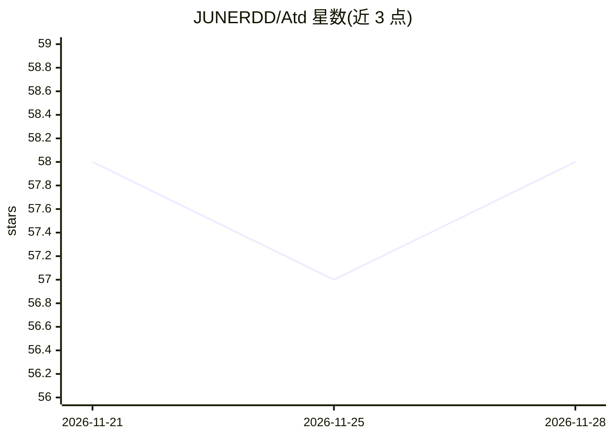

# JUNERDD/Atd

⭐ 58 · TypeScript · MIT · 推送 2026-11-27 · [GitHub](https://github.com/JUNERDD/Atd) · [官网](https://atd.best) · 个人维护

**macOS 开源桌面 AI 代理：对话、computer use、MCP 与自动化**

Atd 是运行于 macOS 15+ 的开源桌面 AI 代理应用，通过 ⌘⇧ Space 面板发起对话，可携带选中文本、截图、文件等本地上下文；支持接入云端、本地或自定义模型端点，集成 MCP 工具、computer use（浏览器与 Mac 应用控制）、技能与子代理、定时与文件夹触发的自动化，并按任务设置审批权限。以 DMG 安装包分发，分 Apple silicon 与 Intel 两个版本，内置运行所需组件，采用 MIT 许可证。

## 筛选速览

| 维度 | 判定 | 备注 |
|---|---|---|
| AI 角色 | `ai-native` | 本体是模型或模型工具 |
| 许可风险 | `permissive` | MIT |
| 部署形态 | `desktop` | 安装包/桌面程序 |
| 模型依赖 | — | README 未给出锁定关系 |
| 硬件要求 | — | 无带数字的原话,不猜 |
| 安装摩擦 | `low` | 无编译、无系统依赖或容器化 |
| 成熟度 | — | 结构信号不足 |

## 能力要点

- 选中文本/截图/文件直接发起对话，回答可回写替换
- Computer use：在浏览器与 Mac 应用中代为操作，权限可管理
- 支持 MCP 服务器、技能、子代理与定时/文件夹触发自动化
- 本地存储任务历史、记忆与凭据（钥匙串），三种审批模式

## 适用场景

- 选中文字或截图后直接让 AI 改写、解答并回填结果
- 让代理在网站和应用里代为填表、操作
- 把重复工作配置成定时或文件夹触发的自动化
- 连接云端或本地模型端点作为日常桌面助手

## 场景标签

`AI 助手` `GUI 自动化` `浏览器自动化` · 领域:效率与自动化

## 证据(README 行号)

> L10: **A quiet, open-source AI desktop agent for macOS** — _anything, anytime, anywhere, to do._
> L12: Select text, capture your screen, or press **⌘ ⇧ Space** to start a conversation. Atd brings your cloud or local mo

## 星数曲线

2026-11-21 58 → 2026-11-28 58（+0）

---
*卡片 v1 · prompt 1.4 · 生成 2026-11-21 · 置信度 high · 依据 README sha `b22202265a7e` · [字段定义](../../DATASET.md)*
