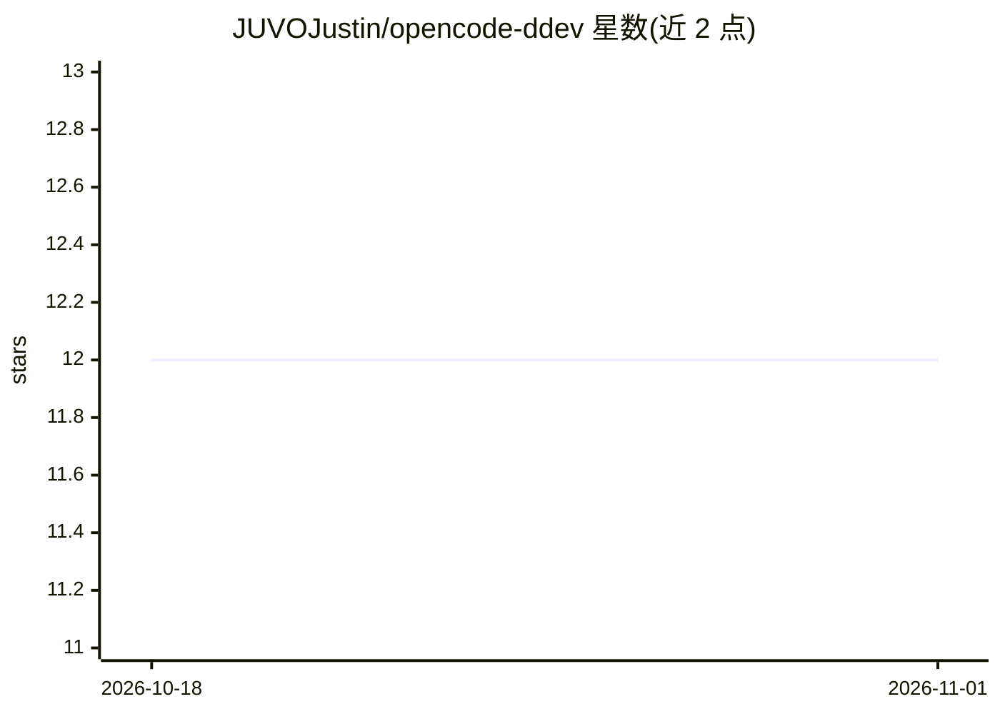

# JUVOJustin/opencode-ddev

⭐ 12 · TypeScript · 推送 2026-03-01 · [GitHub](https://github.com/JUVOJustin/opencode-ddev) · 个人维护

**让 OpenCode AI agent 兼容 DDEV 容器环境的插件**

面向 OpenCode 编码 agent 的插件：检测 DDEV 环境可用性与运行状态，在会话创建和压缩时注入上下文消息，默认命令在宿主机执行、需要容器上下文时提示使用 ddev exec；内置 DDEV agent 技能（CLI 快捷命令、容器路径映射、resolve-ddev-root.sh 脚本定位项目根），并注册 ddev_logs 工具按 service/tail/follow 参数读取 DDEV 服务日志，默认返回 50 行。通过 opencode.json 配置安装，OpenCode 启动时自动安装。

## 筛选速览

| 维度 | 判定 | 备注 |
|---|---|---|
| AI 角色 | `ai-ecosystem` | LLM/agent 周边工具 |
| 许可风险 | `none` | — |
| 部署形态 | `None` |  |
| 模型依赖 | — | README 未给出锁定关系 |
| 硬件要求 | — | 无带数字的原话,不猜 |
| 安装摩擦 | `low` | 无编译、无系统依赖或容器化 |
| 成熟度 | — | 结构信号不足 |

## 能力要点

- 通过 ddev describe -j 检测 DDEV 状态，运行结果缓存 2 分钟
- ddev_logs 工具按服务读取日志，支持 follow/tail/time 参数
- 内置 agent 技能：ddev composer/npm/wp/drush 等快捷命令与容器子路径映射
- 会话创建与压缩后注入容器执行上下文消息

## 适用场景

- 在 DDEV 项目中使用 OpenCode 时获得容器路径提示
- 让 AI agent 读取 DDEV 服务日志排查问题
- 在 WordPress 等 DDEV 项目子目录中正确映射容器路径

## 场景标签

`编码 Agent` · 领域:编码与开发

## 证据(README 行号)

> L3: DDEV Plugin for OpenCode - Detects DDEV availability and provides optional container execution guidance.
> L53: The plugin ships with a bundled DDEV agent skill in `skills/ddev/`. It teaches the AI agent how to work with DDEV p

## 星数曲线

2026-10-18 12 → 2026-11-01 12（+0）

---
*卡片 v1 · prompt 1.4 · 生成 2026-11-01 · 置信度 high · 依据 README sha `602c3681e176` · [字段定义](../../DATASET.md)*
