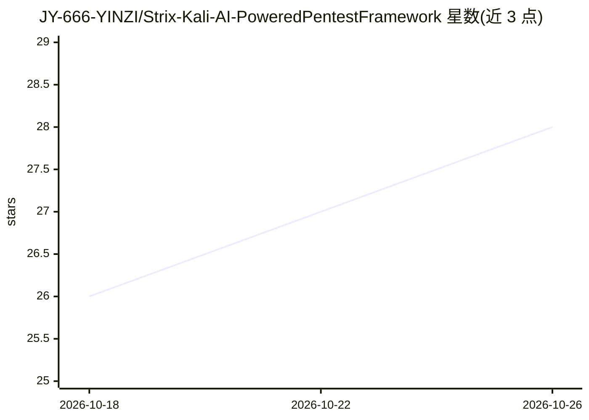

# JY-666-YINZI/Strix-Kali-AI-PoweredPentestFramework

⭐ 28 · GPL-3.0 · 推送 2026-07-14 · [GitHub](https://github.com/JY-666-YINZI/Strix-Kali-AI-PoweredPentestFramework) · 个人维护 · 中文 README

**Strix 自主 AI 渗透测试代理的部署与调优实战指南**

面向 Kali Linux 用户的 Strix 部署指南与工具集：Strix 是行为类似真实黑客的自主 AI 代理，可动态执行本地代码、进行端口侦察、绕过 WAF、测试 IDOR 与业务逻辑漏洞，并在 Docker 沙箱中生成并执行 PoC 做零误报验证。文档覆盖环境准备、国内网络下 0/33 沙箱卡死加速方案、多模型（DeepSeek/Claude/火山引擎/OpenRouter）接入配置，以及用 --instruction 指令引导 AI 注意力的进阶用法。强调仅在获得授权的环境中使用。

## 筛选速览

| 维度 | 判定 | 备注 |
|---|---|---|
| AI 角色 | `ai-knowledge` | 知识聚合/清单类 |
| 许可风险 | `viral` | GPL-3.0 |
| 部署形态 | `self-host` | docker 或自建部署 |
| 模型依赖 | — | README 未给出锁定关系 |
| 硬件要求 | — | 无带数字的原话,不猜 |
| 安装摩擦 | `low` | 无编译、无系统依赖或容器化 |
| 成熟度 | — | 结构信号不足 |

## 能力要点

- 覆盖侦察、WAF 绕过、IDOR/业务逻辑测试与 PoC 生成执行的完整流程
- 多模型接入配置：DeepSeek-V4、Claude、火山引擎、OpenRouter
- 国内网络环境下 Docker 0/33 沙箱卡死加速方案
- 提供 GHCR 容器镜像拉取部署方式

## 适用场景

- 在 Kali Linux 上部署并运行 Strix 自主渗透测试代理
- 为 Strix 配置多服务商大模型后端
- 解决国内网络环境下 Docker 沙箱拉取卡死问题

## 场景标签

`网络安全` `教程课程` · 领域:学习与行业

## 证据(README 行号)

> L18: Strix-Kali-AI is an optimized, high-performance integration guide and toolkit for deploying **Strix**—the autonomou
> L56:  Strix 落地与调教完全指北 —— 这是一个专注于下一代自主 AI 渗透测试代理Strix 的实战部署与性能榨干指南。

## 星数曲线

2026-10-18 26 → 2026-10-26 28（+2）

---
*卡片 v1 · prompt 1.4 · 生成 2026-10-26 · 置信度 low · 依据 README sha `6887cb89a3d5` · [字段定义](../../DATASET.md)*
