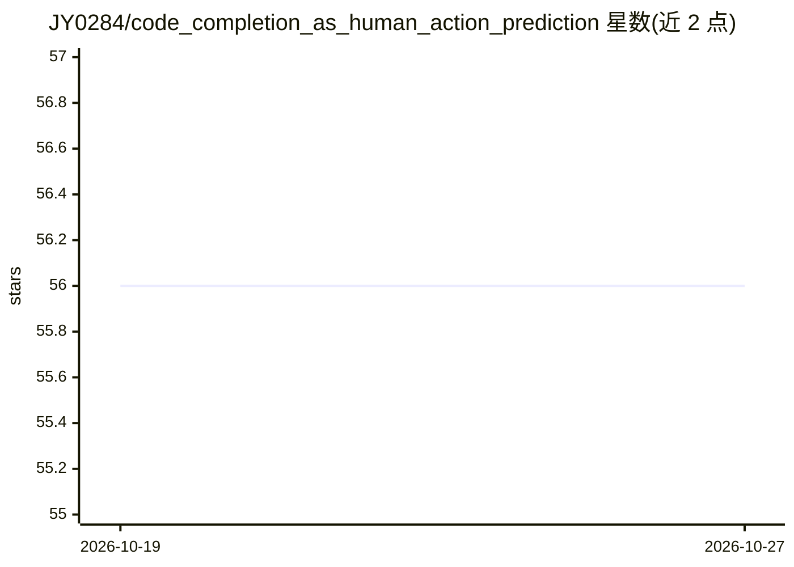

# JY0284/code_completion_as_human_action_prediction

⭐ 56 · Python · 推送 2026-10-19 · [GitHub](https://github.com/JY0284/code_completion_as_human_action_prediction) · [官网](https://dl.acm.org/doi/abs/10.1145/3545258.3545263) · 组织维护 · 中文 README

**2022 论文研究资料：Python 代码动作序列预测方法调用**

Internetware 2022 论文《Represent Code as Action Sequence for Predicting Next Method Call》的研究资料仓库：将 Python 调用、赋值、返回表示为带上下文/执行者/参数的动作序列，供语言模型（论文 6.2 节为 DistilGPT2）预测下一个方法调用 token。仓库含论文草稿、幻灯片、一个仅依赖标准库的 AST 动作抽取演示脚本（Python 3.8/3.12 验证），以及批量抽取与标识符拆分源码；原始训练流程、数据划分与模型权重未包含。草稿报告 Top-5 准确率 81.92%（基线 61.89%）。

## 筛选速览

| 维度 | 判定 | 备注 |
|---|---|---|
| AI 角色 | `ai-knowledge` | 知识聚合/清单类 |
| 许可风险 | `none` | — |
| 部署形态 | `None` |  |
| 模型依赖 | — | README 未给出锁定关系 |
| 硬件要求 | — | 无带数字的原话,不猜 |
| 安装摩擦 | `low` | 无编译、无系统依赖或容器化 |
| 成熟度 | `idea` | |

## 能力要点

- 将 Python 代码经 AST 抽取为 Call/Assign/Return 动作序列
- 标准库即可运行的抽取演示脚本，无需 GPU 或第三方包
- 含论文草稿、幻灯片与复现性说明
- 训练脚本、数据划分与模型权重未发布

## 适用场景

- 了解动作序列表示用于方法调用预测的研究方法
- 复现或阅读该 2022 论文的实验与结果
- 研究者查找该方向的当前开放问题与相关工作

## 场景标签

`代码生成` · 领域:编码与开发

## 证据(README 行号)

> L3: Research materials for **Represent Code as Action Sequence for Predicting Next Method Call**, Internetware 2022.
> L9: The repository contains the paper, presentation, and an early implementation of action extraction and preprocessing.

## 星数曲线

2026-10-19 56 → 2026-10-27 56（+0）

---
*卡片 v1 · prompt 1.4 · 生成 2026-10-24 · 置信度 high · 依据 README sha `8e3e85b57098` · [字段定义](../../DATASET.md)*
