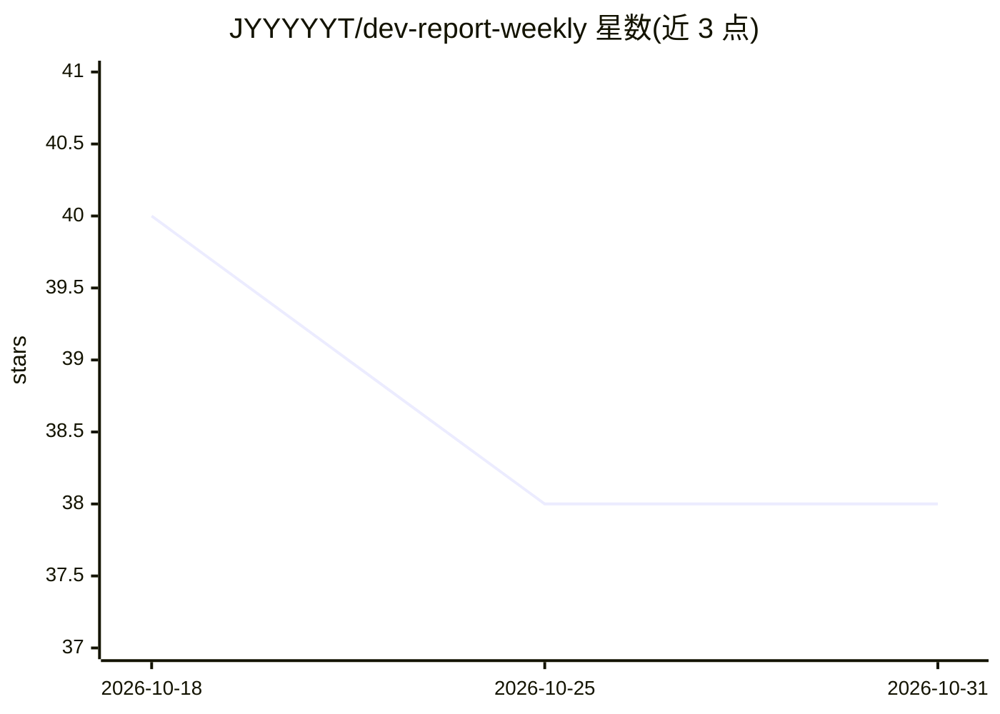

# JYYYYYT/dev-report-weekly

⭐ 38 · TypeScript · Apache-2.0 · 推送 2026-08-20 · [GitHub](https://github.com/JYYYYYT/dev-report-weekly) · 个人维护

**从本地 Git 提交生成可审计周报的桌面应用**

基于 Tauri（React/TypeScript/Rust）的本地优先桌面应用：读取一个或多个本地 Git 仓库的提交，按日期与作者过滤，允许用户在生成前逐条审阅并排除提交，再调用模型生成可编辑的 Markdown 工作周报，并将生成的工作项与所选提交核对。模型接入支持已安装的 Codex 或 Claude Code CLI（需已登录），以及任意 OpenAI 兼容 API（含 Ollama 本地端点，无需 API key）。本地运行需 Node.js 22+、pnpm 10+、Rust stable 与 Tauri 系统依赖。

## 筛选速览

| 维度 | 判定 | 备注 |
|---|---|---|
| AI 角色 | `ai-native` | 本体是模型或模型工具 |
| 许可风险 | `permissive` | Apache-2.0 |
| 部署形态 | `library` | 以包/库形式分发 |
| 模型依赖 | local-ok | 支持本地模型 |
| 硬件要求 | — | 无带数字的原话,不猜 |
| 安装摩擦 | `low` | 无编译、无系统依赖或容器化 |
| 成熟度 | — | 结构信号不足 |

## 能力要点

- 读取多仓库提交并按日期/作者过滤
- 生成前逐条审阅与排除提交
- 生成的工作项与所选提交核对，产出可编辑 Markdown
- 支持本地 Codex/Claude Code CLI 与 OpenAI 兼容端点

## 适用场景

- 基于 Git 提交历史快速撰写周报
- 在发送给模型前人工筛选提交、控制数据外泄
- 用本地模型或本地 agent 离线生成报告

## 场景标签

`AI 写作` · 领域:内容生成

## 证据(README 行号)

> L3: DevWeek is a small desktop app that uses AI to generate work reports from local Git commits.
> L12: - Works with local Codex or Claude Code, as well as OpenAI-compatible APIs.

## 星数曲线

2026-10-18 40 → 2026-10-31 38（-2）

---
*卡片 v1 · prompt 1.4 · 生成 2026-10-25 · 置信度 mid · 依据 README sha `1e190ff8dbd9` · [字段定义](../../DATASET.md)*
