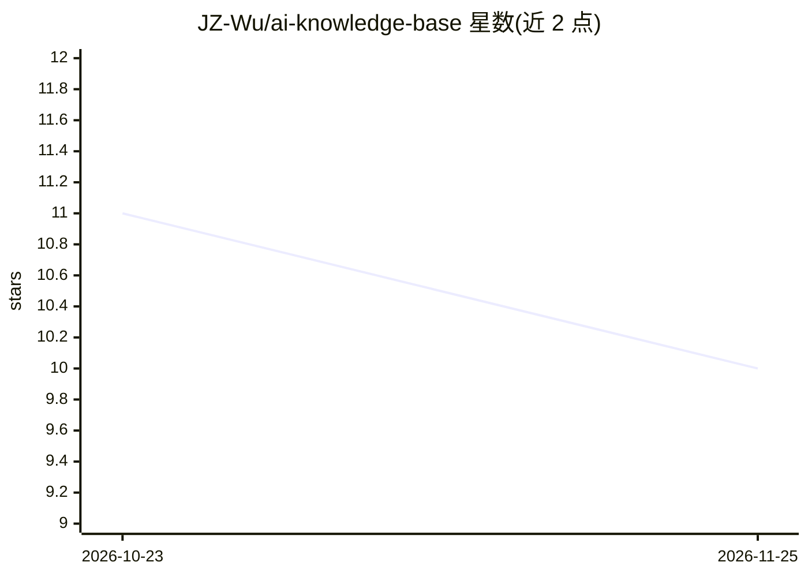

# JZ-Wu/ai-knowledge-base

⭐ 10 · Python · MIT · 推送 2026-06-24 · [GitHub](https://github.com/JZ-Wu/ai-knowledge-base) · 个人维护 · 中文 README

**本地 Markdown 知识库：选中即问 AI 并直接改写源文件**

本地部署运行的 Markdown/PDF 知识库系统：将任意文件夹建为带全文检索的知识库，阅读时选中段落即时向 AI 提问，流式展示回答；可选择让 AI 将续写、改写、整理、翻译结果直接写回 Markdown 源文件。兼容 Claude CLI、Codex CLI 与任意 OpenAI 兼容 API，用户使用自有密钥，数据留存本地。通过 git clone 与 pip 安装，python run.py 一条命令启动，支持 Windows/macOS/Linux。

## 筛选速览

| 维度 | 判定 | 备注 |
|---|---|---|
| AI 角色 | `ai-native` | 本体是模型或模型工具 |
| 许可风险 | `permissive` | MIT |
| 部署形态 | `library` | 以包/库形式分发 |
| 模型依赖 | locked-api |  |
| 硬件要求 | — | 无带数字的原话,不猜 |
| 安装摩擦 | `low` | 无编译、无系统依赖或容器化 |
| 成熟度 | — | 结构信号不足 |

## 能力要点

- 选中任意段落一键问 AI，回答流式弹出
- AI 生成结果可直接写回 Markdown 源文件（续写/改写/整理/翻译）
- 兼容 Claude CLI、Codex CLI 与任意 OpenAI 兼容 API，本地留存数据
- 内置 PDF 阅读器：选中问 AI、高亮、行内评论、阅读进度记忆

## 适用场景

- 把笔记目录变成可全文检索并可向 AI 提问的知识库
- 阅读 PDF 时对选中内容即时提问并做批注
- 让 AI 直接改写笔记原文完成翻译或内容整理

## 场景标签

`知识库管理` `文档问答` `AI 写作` · 领域:内容生成

## 证据(README 行号)

> L15: **AskMD** 是一个本地部署并运行的知识库系统，支持对包含 Markdown、图片与 PDF 格式文件的任意文件夹进行**检索**与**智能问答/修改**。在阅读文件过程中，可对任意文本段落进行选取，并直接调用 AI 模型进
> L24: - 🤖 **选中即问** —— 阅读时选中任意段落，一键问 AI，回答在页面右侧流式弹出。
> L29: - 🔌 **接你自己的模型** —— 支持 Claude CLI、Codex CLI 与任意 OpenAI 兼容 API，全部本地运行。

## 星数曲线

2026-10-23 11 → 2026-11-25 10（-1）

---
*卡片 v1 · prompt 1.4 · 生成 2026-11-19 · 置信度 high · 依据 README sha `8960c6f81082` · [字段定义](../../DATASET.md)*
