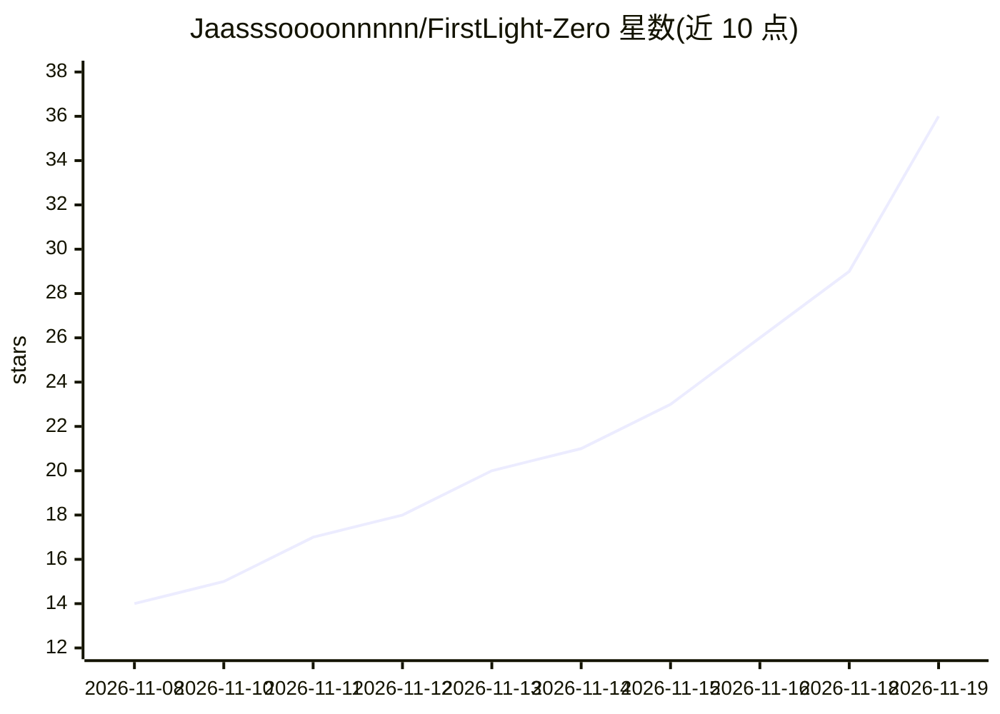

# Jaasssoooonnnnn/FirstLight-Zero

⭐ 36 · Python · Apache-2.0 · 推送 2026-11-04 · [GitHub](https://github.com/Jaasssoooonnnnn/FirstLight-Zero) · 个人维护 · 中文 README

**纯自博弈训练的 Clash Royale PPO 模型，胜过模仿学习模型**

AlphaZero 风格的 Clash Royale AI 项目：1.17M 参数的 PPO 模型完全通过自博弈（与自身及历史版本对局）从随机权重训练，不使用人类对局数据，学会 3.0 X-Bow 镜像对局。训练 1,450 轮后，对 16.8M 参数、基于 193,530 场顶级天梯对局训练的模仿学习模型（IL Model Everlight）胜率达 97.5%。仓库含训练与评估代码、native_runner 战斗环境层（裁剪自 FirstLight CR）、v50-v1500 每 50 版 checkpoint。运行需 Python 3.12、训练用 GPU 及版本 15.535.13 的原生战斗引擎（不含游戏客户端）。

## 筛选速览

| 维度 | 判定 | 备注 |
|---|---|---|
| AI 角色 | `ai-native` | 本体是模型或模型工具 |
| 许可风险 | `permissive` | Apache-2.0 |
| 部署形态 | `library` | 以包/库形式分发 |
| 模型依赖 | — | README 未给出锁定关系 |
| 硬件要求 | — | 无带数字的原话,不猜 |
| 安装摩擦 | `low` | 无编译、无系统依赖或容器化 |
| 成熟度 | — | 结构信号不足 |

## 能力要点

- 无人类数据，仅自博弈训练至胜过模仿学习模型
- 对 16.8M 参数 IL 模型胜率 97.5%（v1460，40 局评估）
- 包含 v50-v1500 每 50 版 checkpoint
- 提供训练、评估、推理服务器与回放导出工具

## 适用场景

- 研究零人类数据的自博弈强化学习训练
- 复现或评估 Clash Royale X-Bow 镜像对局 AI
- 分析自博弈模型逐版本棋力演变

## 场景标签

`强化学习` · 领域:训练与推理

## 证据(README 行号)

> L4:  A small Clash Royale model that learned the 3.0 X-Bow mirror from self-play alone, with no human data.
> L8:  PPO self-play
> L20: After 1,450 training rounds, the 1.17M-parameter model beats a 16.8M-parameter imitation model that was trained on 

## 星数曲线

2026-11-08 14 → 2026-11-19 36（+22）

---
*卡片 v1 · prompt 1.4 · 生成 2026-11-18 · 置信度 mid · 依据 README sha `17f76d8055f3` · [字段定义](../../DATASET.md)*
