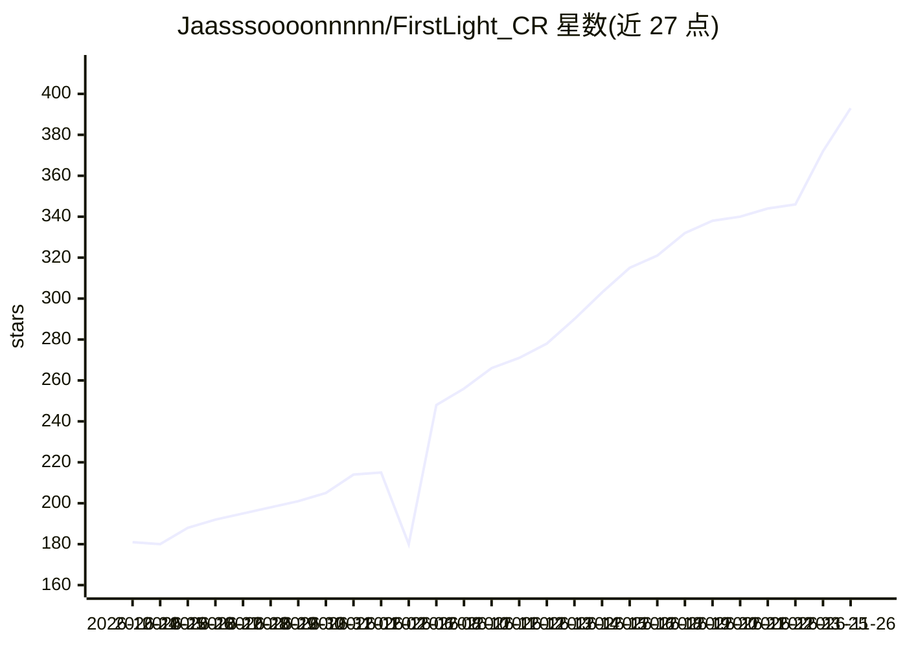

# Jaasssoooonnnnn/FirstLight_CR

⭐ 393 · Python · Apache-2.0 · 推送 2026-10-31 · [GitHub](https://github.com/Jaasssoooonnnnn/FirstLight_CR) · 个人维护 · 中文 README

**训练皇室战争离线对战 AI 的研究工具包**

面向皇室战争的离线 AI 研究项目：提供原生对战环境（headless/渲染执行、Python reset/step 接口）、将 Parquet 回放重建为观测-动作序列的模仿学习、带匹配与对手池的 PPO 自博弈强化学习及分布式采集。内置 V4 actor-critic 模型、5 个 checkpoint 与 252,238 条回放数据集，支持与模型对战、手动操作双方、查看回放的本地界面。支持 CPU 推理；构建离线 APK 需 JDK 17、Android NDK、SDK build-tools 与 MuMu 模拟器，引擎依赖指定版本的 Null's Royale APK（用户自备）。

## 筛选速览

| 维度 | 判定 | 备注 |
|---|---|---|
| AI 角色 | `ai-native` | 本体是模型或模型工具 |
| 许可风险 | `permissive` | Apache-2.0 |
| 部署形态 | `desktop` | 安装包/桌面程序 |
| 模型依赖 | — | README 未给出锁定关系 |
| 硬件要求 | — | 无带数字的原话,不猜 |
| 安装摩擦 | `medium` | 含编译或系统依赖之一 |
| 成熟度 | — | 结构信号不足 |

## 能力要点

- 原生对战环境：headless/渲染执行与 Python reset/step 接口
- 模仿学习：重建 Parquet 回放为 IL 训练序列
- PPO 自博弈：匹配、对手池、常驻模拟、分布式采集
- 5 个内置 checkpoint，122 张支持卡牌，252K 回放数据集

## 适用场景

- 训练并评估皇室战争对战 AI agent
- 在回放数据上做模仿学习研究
- 本地与模型对战或查看自博弈回放

## 场景标签

`强化学习` · 领域:训练与推理

## 证据(README 行号)

> L38: - **Native battle environment.** Headless and rendered execution, structured observations, card deployment and abil
> L40: - **Self-play reinforcement learning.** PPO with matchmaking, opponent pools, resident simulation, and distributed 
> L5:  Train Clash Royale agents and play offline, with imitation learning and PPO self-play.

## 星数曲线

2026-10-24 181 → 2026-11-26 393（+212）

---
*卡片 v1 · prompt 1.4 · 生成 2026-11-25 · 置信度 high · 依据 README sha `e72919b788fc` · [字段定义](../../DATASET.md)*
