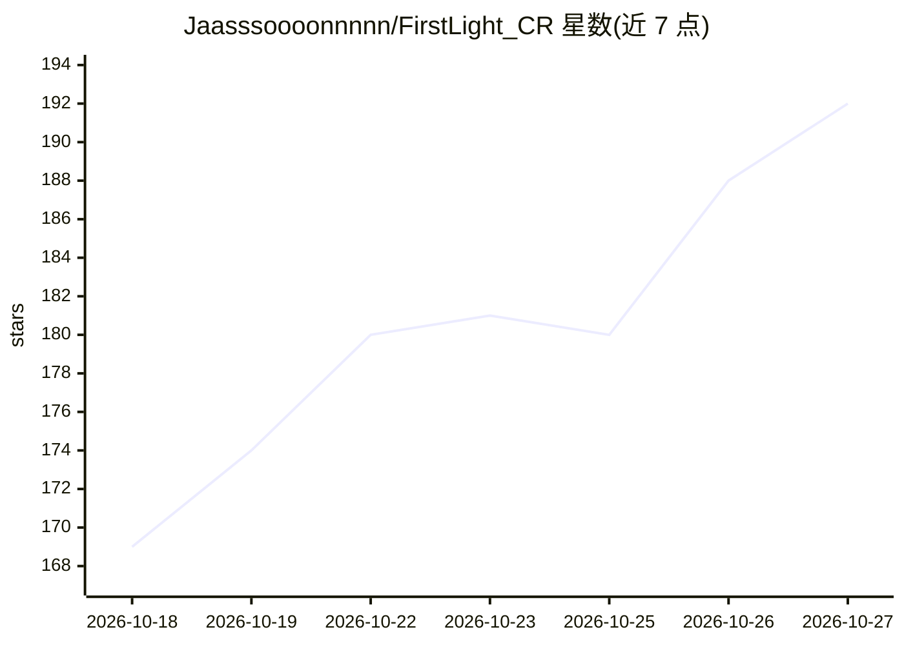

# Jaasssoooonnnnn/FirstLight_CR

⭐ 192 · Python · Apache-2.0 · 推送 2026-10-04 · [GitHub](https://github.com/Jaasssoooonnnnn/FirstLight_CR) · 个人维护 · 中文 README

**离线训练与评测 Clash Royale AI agent 的研究框架**

面向游戏 AI 研究者的完整流水线：基于原生对局引擎（headless 与渲染两种执行）重放 252K 局对局构建观测/动作序列做模仿学习，再用 PPO 自陪练（含匹配、对手池、常驻仿真与分布式采样）训练 actor-critic 模型；提供 5 个 checkpoint、策略 JSON-lines 服务与双模型对局评测命令。桌面环境依赖 Windows、Python 3.12、MuMu 模拟器（Android 12、root、ARM64）与用户自备的指定版本 APK；从源码构建离线 APK 需 JDK 17/NDK，直接运行已构建 APK 则不需要。不分发游戏 APK 及资源，与 Supercell 无关联。

## 筛选速览

| 维度 | 判定 | 备注 |
|---|---|---|
| AI 角色 | `ai-native` | 本体是模型或模型工具 |
| 许可风险 | `permissive` | Apache-2.0 |
| 部署形态 | `desktop` | 安装包/桌面程序 |
| 模型依赖 | — | README 未给出锁定关系 |
| 硬件要求 | — | 无带数字的原话,不猜 |
| 安装摩擦 | `medium` | 含编译或系统依赖之一 |
| 成熟度 | — | 结构信号不足 |

## 能力要点

- 原生对局环境：Python reset/step 接口、结构化观测、122 张支持卡牌
- 模仿学习 + PPO 自陪练（对手池、分布式采样）
- 252,238 局重放数据集托管于 Hugging Face，含 17,836,160 个动作
- V4 actor-critic 使用卡牌特征、实体关系、空间特征与循环记忆

## 适用场景

- 离线训练自己的 Clash Royale 对战 AI 模型
- 用模仿学习从重放数据起步，再切换 PPO 自陪练
- 在离线模拟器中与模型对局或对比两个 checkpoint 的胜率
- 通过 JSON-lines 策略服务接入自定义 actor 循环

## 场景标签

`模型训练` `强化学习` `模型评测` · 领域:评测与运维

## 证据(README 行号)

> L37: - **Imitation learning.** Reconstruct Parquet replays in the engine and build observation/action sequences for IL t
> L38: - **Self-play reinforcement learning.** PPO with matchmaking, opponent pools, resident simulation, and distributed 
> L39: - **Models and inputs.** The V4 actor-critic uses card features, entity relations, spatial features, and recurrent 

## 星数曲线

2026-10-18 169 → 2026-10-27 192（+23）

---
*卡片 v1 · prompt 1.4 · 生成 2026-10-22 · 置信度 mid · 依据 README sha `02f490a98606` · [字段定义](../../DATASET.md)*
