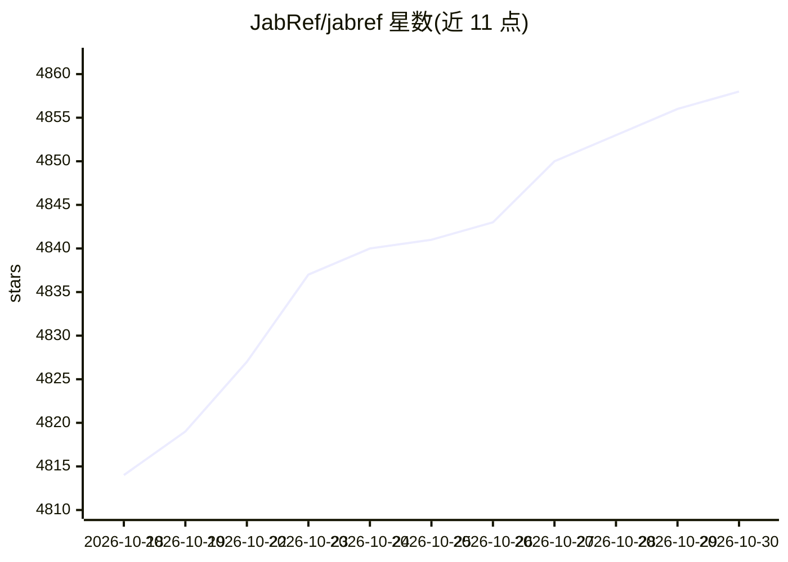

# JabRef/jabref

⭐ 4,858 · Java · MIT · 推送 2026-10-29 · [GitHub](https://github.com/JabRef/jabref) · [官网](https://www.jabref.org) · 组织维护

**跨平台开源文献引用与 BibTeX 参考文献管理桌面应用**

面向科研人员的引用与参考文献管理工具：从 CrossRef、Google Scholar、arXiv 等在线目录检索并导入文献，支持 15 种以上引用格式导入、按 ISBN/DOI/arXiv-ID 抓取书目信息、PDF 元数据提取与浏览器插件一键导入。组织层面提供分组、去重合并、自定义引用键生成与文档自动重命名。原生支持 BibTeX/BibLaTeX，可对接 Emacs/LyX/Vim 等编辑器及 Word/LibreOffice 插入引用，库以纯文本保存并可通过 SQL 数据库团队同步。另提供 JabKit 命令行工具，支持 JBang 运行与 Docker 镜像。

## 筛选速览

| 维度 | 判定 | 备注 |
|---|---|---|
| AI 角色 | `ai-enhanced` | 去掉 AI 部分产品仍成立 |
| 许可风险 | `permissive` | MIT |
| 部署形态 | `self-host` | docker 或自建部署 |
| 模型依赖 | — | README 未给出锁定关系 |
| 硬件要求 | — | 无带数字的原话,不猜 |
| 安装摩擦 | `low` | 无编译、无系统依赖或容器化 |
| 成熟度 | — | 结构信号不足 |

## 能力要点

- 从多个在线学术目录检索并导入文献，支持 15+ 格式
- 基于 ISBN/DOI/PubMed-ID/arXiv-ID 抓取完整书目信息
- 原生 BibTeX/BibLaTeX 支持，数千种内置引用样式
- 库以纯文本文件保存，可通过 SQL 数据库团队同步

## 适用场景

- 科研写作时管理 .bib 文献库并在 LaTeX 中引用
- 批量整理、去重并补全文献元数据
- 团队共享与同步参考文献库

## 场景标签

`科研工具` · 领域:学习与行业

## 证据(README 行号)

> L3: JabRef is an open-source, cross-platform citation and reference management tool.
> L16: - Search across many online scientific catalogues like CrossRef, Google Scholar, IEEEXplore, INSPIRE-HEP, Medline P
> L37: - Native BibTeX and BibLaTeX support

## 星数曲线

2026-10-18 4,814 → 2026-10-30 4,858（+44）

---
*卡片 v1 · prompt 1.4 · 生成 2026-10-21 · 置信度 low · 依据 README sha `baefd3c5e519` · [字段定义](../../DATASET.md)*
