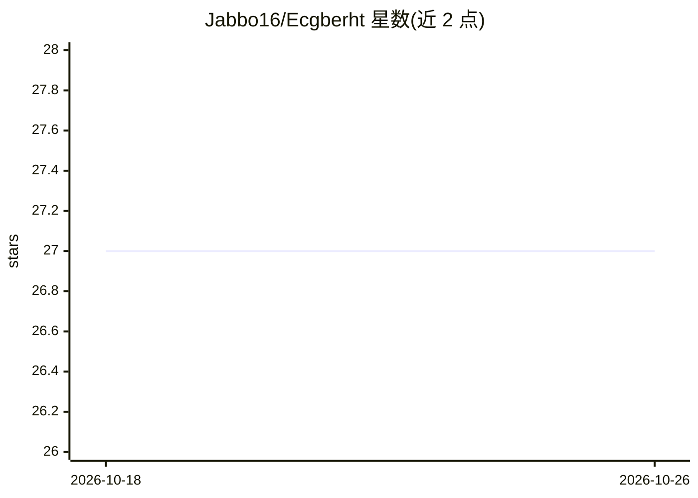

# Jabbo16/Ecgberht

⭐ 27 · Java · MIT · 推送 2026-09-27 · [GitHub](https://github.com/Jabbo16/Ecgberht) · 个人维护

**Java 编写的星际争霸母巢之战 AI 机器人，专打人族**

基于 BWAPI4J 框架用 Java 编写的 Starcraft: Brood War 游戏 AI，仅支持人族（Terran）打法，可执行多种倾向生物部队（机枪兵+医疗兵）的策略。实现 UCB-1 算法根据对局历史学习策略选择，并使用高斯均值漂移聚类（GMS）做战斗模拟。通过 config.json 配置调试选项与声音等。构建需 32 位 JDK8，用 Gradle wrapper 打包 fat jar，再以 32 位 java.exe 运行。目前参加 SSCAIT 与 BASIL 天梯。

## 筛选速览

| 维度 | 判定 | 备注 |
|---|---|---|
| AI 角色 | `ai-native` | 本体是模型或模型工具 |
| 许可风险 | `permissive` | MIT |
| 部署形态 | `desktop` | 安装包/桌面程序 |
| 模型依赖 | — | README 未给出锁定关系 |
| 硬件要求 | — | 无带数字的原话,不猜 |
| 安装摩擦 | `medium` | 含编译或系统依赖之一 |
| 成熟度 | — | 结构信号不足 |

## 能力要点

- 仅支持人族，偏好 Bio（机枪兵/医疗兵）策略并混入机械化单位
- UCB-1 算法根据对手对局历史学习策略选择
- 高斯均值漂移聚类（GMS）用于战斗模拟
- config.json 可配置调试选项、声音等

## 适用场景

- 在 SSCAIT/BASIL 天梯上参加星际争霸 AI 对战
- 通过 BWAPI 在本地星际争霸中运行 AI 对手
- 研究博弈 AI 的策略选择与战斗模拟算法实现

## 场景标签

 · 领域:游戏 AI/机器人

## 证据(README 行号)

> L7: Ecgberht is a `Starcraft: Brood War` AI written in Java.
> L25: * Implements UCB-1 algorithm for learning best strategy to pick depending of opponent game history.

## 星数曲线

2026-10-18 27 → 2026-10-26 27（+0）

---
*卡片 v1 · prompt 1.4 · 生成 2026-10-26 · 置信度 high · 依据 README sha `9a454a0e8a6f` · [字段定义](../../DATASET.md)*
