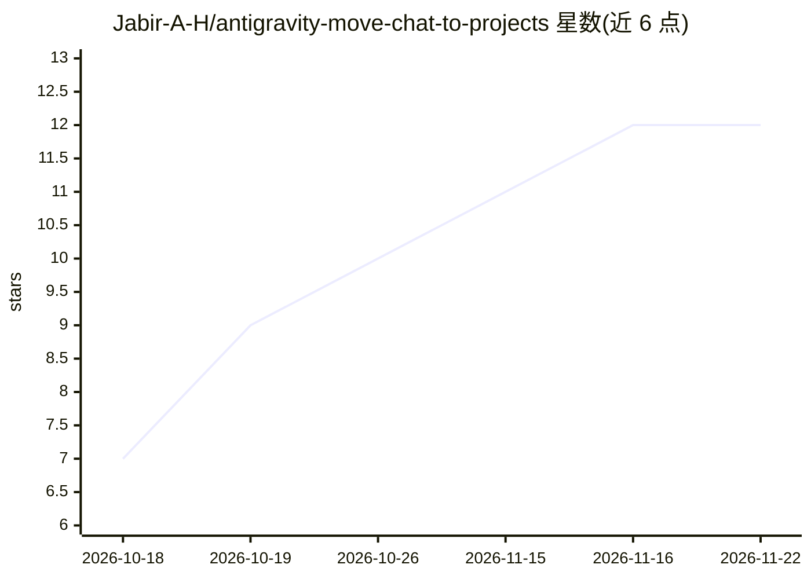

# Jabir-A-H/antigravity-move-chat-to-projects

⭐ 12 · Python · MIT · 推送 2026-09-11 · [GitHub](https://github.com/Jabir-A-H/antigravity-move-chat-to-projects) · 个人维护

**为 Google Antigravity 用户迁移/备份跨工作区对话的 CLI 工具**

单文件 Python 脚本 transplant_chat.py，针对 Google Antigravity Desktop App 与 Antigravity IDE：在同一机器的工作区之间直接移植对话，或通过 zip 导出/导入实现跨设备迁移与备份。处理 SQLite 会话数据库、brain 目录产物（计划、transcript）、.pbtxt 侧边栏标题等，并保留工作区绑定的 Protobuf 头与哈希。修改前自动生成带时间戳的数据库与 brain 备份以支持回滚。零外部依赖，仅需 Python 3.8+。

## 筛选速览

| 维度 | 判定 | 备注 |
|---|---|---|
| AI 角色 | `ai-enhanced` | 去掉 AI 部分产品仍成立 |
| 许可风险 | `permissive` | MIT |
| 部署形态 | `library` | 以包/库形式分发 |
| 模型依赖 | — | README 未给出锁定关系 |
| 硬件要求 | — | 无带数字的原话,不猜 |
| 安装摩擦 | `low` | 无编译、无系统依赖或容器化 |
| 成熟度 | — | 结构信号不足 |

## 能力要点

- 同机工作区间直接移植对话（自动检测 Desktop App 或 IDE）
- zip 导出/导入实现跨设备迁移与备份，可 --info 检查归档
- 修改前自动创建数据库与 brain 目录的时间戳备份
- 零外部依赖，仅用标准库（sqlite3/zipfile/argparse 等）

## 适用场景

- 把在无工作区模式或错误项目中开始的对话移到目标项目
- 在个人电脑与办公电脑之间携带完整对话与计划状态
- 把卡在 IDE 中的对话移植到 Desktop App 以便继续访问
- 对重要 AI 对话做独立 zip 备份

## 场景标签

 · 领域:开发者工具/AI 工作流辅助

## 证据(README 行号)

> L9: A lightweight, zero-dependency CLI utility to move, migrate, backup, export, and transplant conversations, agent tra
> L31: 2. **Desktop App & Antigravity IDE Support:** Seamlessly works with both **Antigravity Desktop App** (`~/.gemini/an
> L203: - **Dependencies**: None (uses standard Python library: `sqlite3`, `zipfile`, `tempfile`, `json`, `shutil`, `re`, 

## 星数曲线

2026-10-18 7 → 2026-11-22 12（+5）

---
*卡片 v1 · prompt 1.4 · 生成 2026-11-18 · 置信度 mid · 依据 README sha `acab3f2fe3c7` · [字段定义](../../DATASET.md)*
