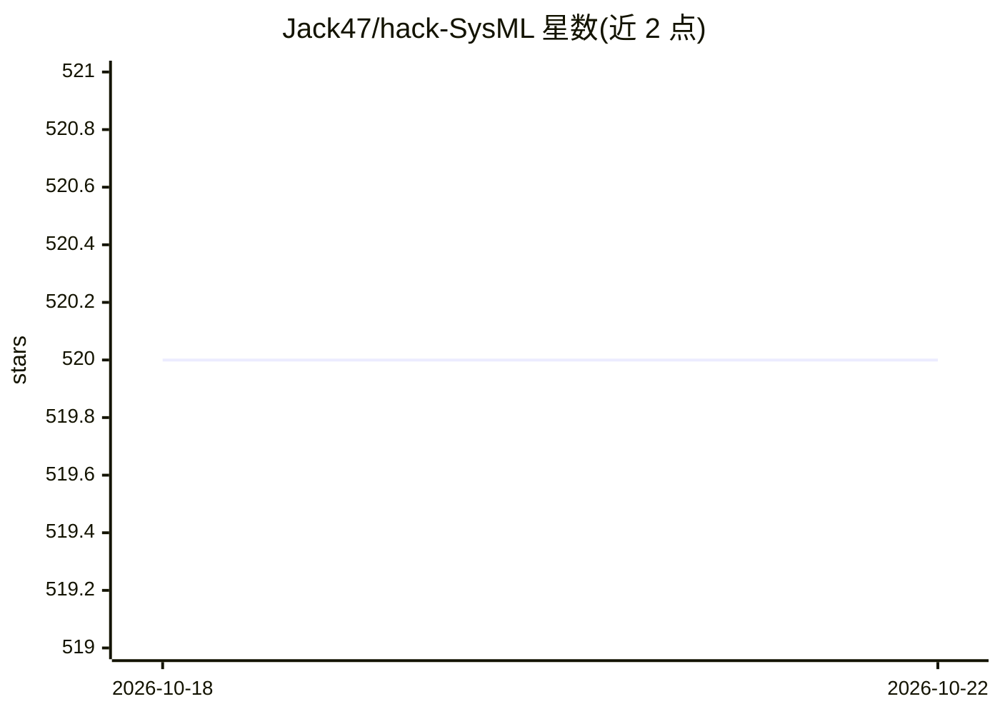

# Jack47/hack-SysML

⭐ 520 · Emacs Lisp · 推送 2026-10-07 · [GitHub](https://github.com/Jack47/hack-SysML) · 个人维护 · 中文 README

**个人 SysML 学习路线笔记：聚合论文、课程与开源框架资源**

作者以 3-5 年成为 SysML（机器学习系统）专家为目标的个人学习笔记仓库：收集机器学习系统方向的论文、课程、视频、开源框架与基础概念，形成路线图。采用受 Karpathy LLM Wiki 启发的三层工作流维护知识：raw/ 存放不可变源材料，wiki/ 存放由 agent 维护的交叉链接综合笔记，AGENTS.md 定义摄取、查询与 lint 工作流。从 wiki/index.md 开始浏览，原有主题目录保留并可渐进迁移。

## 筛选速览

| 维度 | 判定 | 备注 |
|---|---|---|
| AI 角色 | `ai-knowledge` | 知识聚合/清单类 |
| 许可风险 | `none` | — |
| 部署形态 | `None` |  |
| 模型依赖 | — | README 未给出锁定关系 |
| 硬件要求 | — | 无带数字的原话,不猜 |
| 安装摩擦 | `low` | 无编译、无系统依赖或容器化 |
| 成熟度 | — | 结构信号不足 |

## 能力要点

- 聚合 SysML 方向的论文、课程、视频与开源框架路线图
- raw/wiki/AGENTS.md 三层 LLM 维护工作流
- wiki/ 目录存放 agent 维护的交叉链接综合笔记

## 适用场景

- 按路线图自学机器学习系统（SysML）方向
- 查找 SysML 相关论文、课程与开源框架资源
- 了解 LLM 维护个人知识库的一种组织方式

## 场景标签

`教程课程` `知识库管理` · 领域:知识与检索

## 证据(README 行号)

> L1: This repo is my notes on **learning and practicing SysML**. It contains a road map which includes awesome papers, co
> L7: New sources and synthesized notes follow a three-layer workflow inspired by Karpathy's LLM Wiki:

## 星数曲线

2026-10-18 520 → 2026-10-22 520（+0）

---
*卡片 v1 · prompt 1.4 · 生成 2026-10-21 · 置信度 high · 依据 README sha `00eeddb637b6` · [字段定义](../../DATASET.md)*
