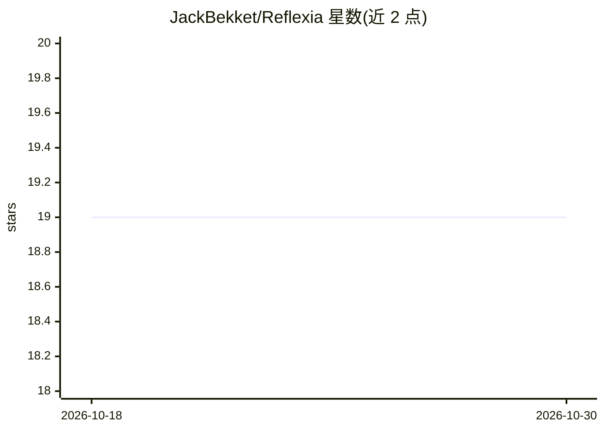

# JackBekket/Reflexia

⭐ 19 · Go · 推送 2025-11-19 · [GitHub](https://github.com/JackBekket/Reflexia) · 个人维护

**代码仓库文档生成与分析工具：自动化分析并支持 GitHub 集成**

以 Go 编写、提供 CLI 与 API 两种入口的项目分析工具：按语言专属 TOML 配置（go.toml、cpp.toml 等）执行代码分析，支持生成文件摘要（FILES.md）、覆盖 README、创建 PR，并可通过配置的 embeddings 服务 URL 将信息存入向量库。CLI 通过 go build 构建，API 服务通过构建标签启用，需设置 LISTEN_ADDR 与 CORS_ALLOW_ORIGINS 环境变量。README 声明项目处于早期开发阶段，缺少完整错误处理与测试覆盖。

## 筛选速览

| 维度 | 判定 | 备注 |
|---|---|---|
| AI 角色 | `ai-native` | 本体是模型或模型工具 |
| 许可风险 | `none` | — |
| 部署形态 | `None` |  |
| 模型依赖 | — | README 未给出锁定关系 |
| 硬件要求 | — | 无带数字的原话,不猜 |
| 安装摩擦 | `low` | 无编译、无系统依赖或容器化 |
| 成熟度 | `idea` | |

## 能力要点

- 按语言 TOML 配置执行项目分析与规则控制
- 支持生成 FILES.md 文件摘要与覆盖 README、创建 PR
- 可选接入 embeddings 服务将信息存入向量库
- 同一代码库通过构建标签分别构建 CLI 与 API 服务

## 适用场景

- 自动为我的代码仓库生成并更新文档
- 在 CI 流程中自动分析项目并提交 PR
- 将仓库信息向量化以便后续交互

## 场景标签

 · 领域:开发者工具/代码文档

## 证据(README 行号)

> L43: |`-embeddings-url`|Embeddings AI URL|
> L56: |`-use-files`|Save file summaries to `FILES.md` (implies `ReflexiaOpts.WithFileSummary = true`)|

## 星数曲线

2026-10-18 19 → 2026-10-30 19（+0）

---
*卡片 v1 · prompt 1.4 · 生成 2026-10-29 · 置信度 mid · 依据 README sha `7f13790b28b7` · [字段定义](../../DATASET.md)*
