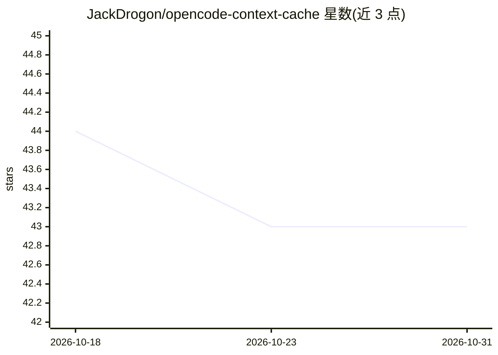

# JackDrogon/opencode-context-cache

⭐ 43 · JavaScript · MIT · 推送 2026-02-14 · [GitHub](https://github.com/JackDrogon/opencode-context-cache) · [官网](https://opencode.ai/docs/plugins/) · 个人维护

**OpenCode 插件：生成稳定缓存键提升 prompt cache 命中率**

面向 OpenCode 的插件（ESM .mjs 文件），通过 chat.params 钩子生成稳定的缓存键并 SHA256 哈希后同时写入 output.options.promptCacheKey 与 x-session-id/conversation_id/session_id 头，使各 provider 的路由与缓存身份保持一致。默认键为 user@host:<绝对路径>，支持环境变量覆盖与防二次哈希。README 记录一次实测：输入缓存命中率从接近零升至 97.99%。限制：须在 opencode.jsonc 显式声明 plugin 字段才能生效，移动项目路径会改变默认键。

## 筛选速览

| 维度 | 判定 | 备注 |
|---|---|---|
| AI 角色 | `ai-ecosystem` | LLM/agent 周边工具 |
| 许可风险 | `permissive` | MIT |
| 部署形态 | `None` |  |
| 模型依赖 | — | README 未给出锁定关系 |
| 硬件要求 | — | 无带数字的原话,不猜 |
| 安装摩擦 | `low` | 无编译、无系统依赖或容器化 |
| 成熟度 | — | 结构信号不足 |

## 能力要点

- 稳定缓存键经 SHA256 哈希后同时写入 promptCacheKey 与三个会话头
- 缓存键优先级链：环境变量 > user@host:cwd > 既有头 > sessionID
- provider 无关，无分支逻辑，适用于所有已配置 provider
- 实测一次运行输入缓存命中率达 97.99%（164736/168112）

## 适用场景

- 使用 OpenCode 时降低重复会话的 token 成本
- AI API 中转/网关场景下稳定会话路由与缓存身份
- 多 provider 切换时保持缓存键一致

## 场景标签

 · 领域:AI 开发工具/LLM 缓存

## 证据(README 行号)

> L3: Enhanced prompt cache and sticky session management plugin for OpenCode.
> L83: - Runtime: OpenCode plugin system (`chat.params` hook)
> L137: The plugin registers the `chat.params` hook and:

## 星数曲线

2026-10-18 44 → 2026-10-31 43（-1）

---
*卡片 v1 · prompt 1.4 · 生成 2026-10-25 · 置信度 high · 依据 README sha `cee5e9b726a3` · [字段定义](../../DATASET.md)*
