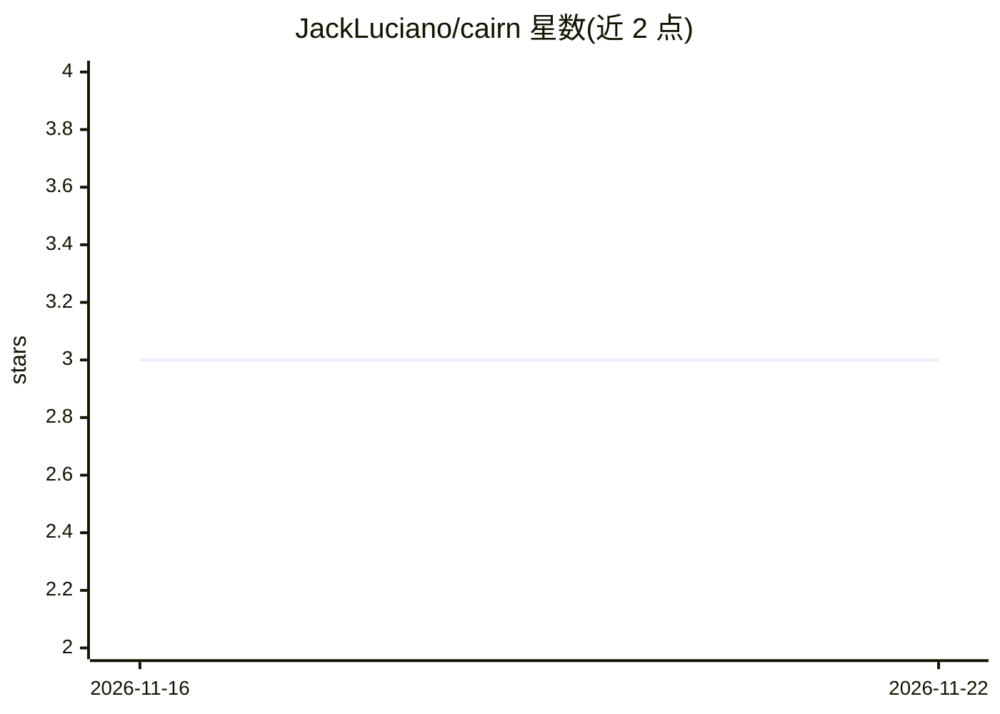

# JackLuciano/cairn

⭐ 3 · Rust · NOASSERTION · 推送 2026-11-16 · [GitHub](https://github.com/JackLuciano/cairn) · 个人维护

**面向进阶开发者的 Windows 原生 git 图形客户端**

以 Rust + GPUI 编写、GPU 渲染、无 Electron/Web view 的桌面 git 客户端，当前标注支持 Windows 平台。功能覆盖行级暂存、交互式 rebase、absorb/split、三方冲突编辑器、stacked pull requests、多仓库工作区、子模块与 Git LFS 管理；每个操作前保存撤销点，支持找回已删除分支与未提交修改。AI 功能包括从 diff 起草提交信息、将未提交改动拆分为逻辑提交、起草 PR 标题与描述、生成行级评审评论、解释 CI 失败原因，通过用户配置的 AI provider 调用。安装提供安装包与源码构建两种途径。

## 筛选速览

| 维度 | 判定 | 备注 |
|---|---|---|
| AI 角色 | `ai-enhanced` | 去掉 AI 部分产品仍成立 |
| 许可风险 | `permissive` | NOASSERTION |
| 部署形态 | `desktop` | 安装包/桌面程序 |
| 模型依赖 | — | README 未给出锁定关系 |
| 硬件要求 | — | 无带数字的原话,不猜 |
| 安装摩擦 | `low` | 无编译、无系统依赖或容器化 |
| 成熟度 | — | 结构信号不足 |

## 能力要点

- 每次操作前自动保存撤销点，支持找回丢失的提交与未提交改动
- AI 从 diff/commits 起草提交信息、PR 描述、评审评论与 CI 失败解释
- 交互式 rebase、absorb/split、stacked PR 自动 restack
- GitHub 集成：PR 评审、issues、通知、CI 检查、发布（依赖 GitHub CLI）

## 适用场景

- 管理多个仓库并批量执行 commit/pull/push
- 用图形界面安全地进行交互式 rebase 与历史改写
- 在客户端内完成 PR 评审、stacked PR 与 CI 排查
- 让 AI 按团队规范起草提交信息与 PR 描述

## 场景标签

`代码审查` · 领域:编码与开发

## 证据(README 行号)

> L5: **A fast, friendly git client for people who outgrew the basics.**
> L61: **AI commit messages.** "Write message from diff" drafts a summary and description from your
> L167: - **AI review.** One click and your AI provider reads the whole pull request and drafts review comments on

## 星数曲线

2026-11-16 3 → 2026-11-22 3（+0）

---
*卡片 v1 · prompt 1.4 · 生成 2026-11-22 · 置信度 high · 依据 README sha `3b7dbddce3b7` · [字段定义](../../DATASET.md)*
