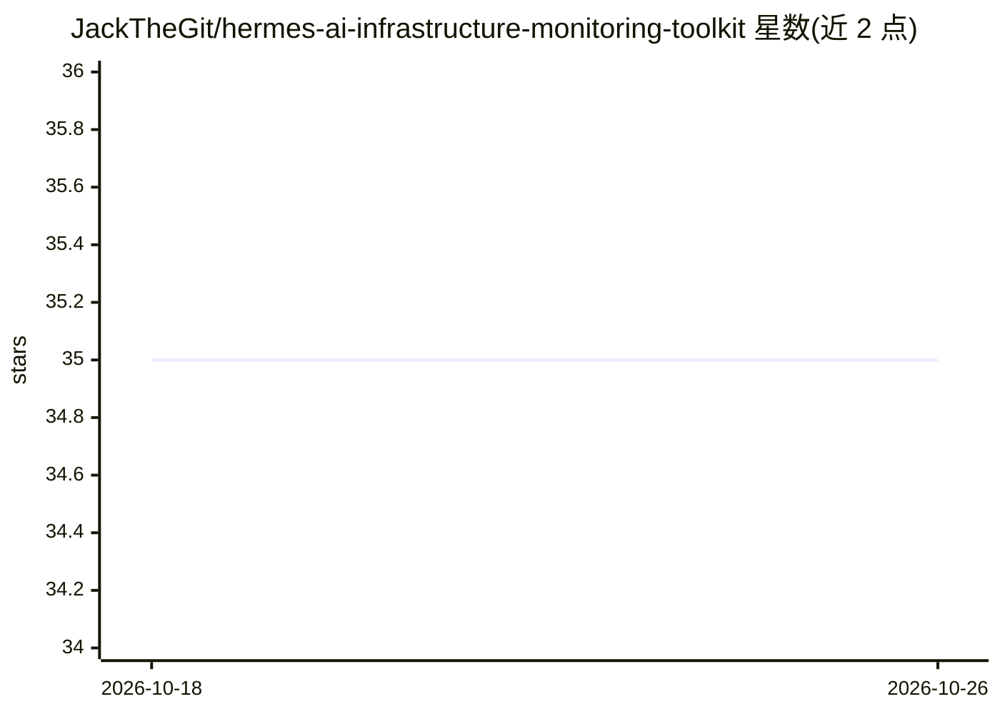

# JackTheGit/hermes-ai-infrastructure-monitoring-toolkit

⭐ 35 · NOASSERTION · 推送 2026-07-15 · [GitHub](https://github.com/JackTheGit/hermes-ai-infrastructure-monitoring-toolkit) · 个人维护

**基于 Hermes Agent 的 AI 基础设施自主监控工具包**

为 Hermes Agent Hackathon（Nous Research）创建的演示项目，提供以 cron 调度的自主 Hermes 工作流参考实现：每 6 小时经 arXiv API 抓取 AI 论文并筛选基础设施相关内容生成摘要，每 12 小时扫描 GitHub 趋势仓库、检测基础设施风险信号、估算 token 消耗与成本，并生成 ASCII 风格监控仪表盘。部署方式为安装 hermes-agent CLI 并手工创建工作区与 cron 任务，运行报告写入 /reports/ 目录。README 提示高频调度会显著增加 token 消耗，建议保守间隔。

## 筛选速览

| 维度 | 判定 | 备注 |
|---|---|---|
| AI 角色 | `ai-ecosystem` | LLM/agent 周边工具 |
| 许可风险 | `none` | NOASSERTION |
| 部署形态 | `library` | 以包/库形式分发 |
| 模型依赖 | — | README 未给出锁定关系 |
| 硬件要求 | — | 无带数字的原话,不猜 |
| 安装摩擦 | `low` | 无编译、无系统依赖或容器化 |
| 成熟度 | `idea` | |

## 能力要点

- arXiv API 自动化研究摄取与结构化摘要报告
- GitHub 趋势扫描跟踪模型服务/推理引擎/分布式训练工具生态
- token 消耗与成本预测建模
- 5 个独立 Hermes cron 工作流生成 Markdown 报告与 ASCII 仪表盘

## 适用场景

- 定时自动追踪 AI 基础设施研究与技术趋势
- 估算自主 agent 的 token 成本与执行量
- 作为构建长期运行 Hermes agent 系统的模板参考

## 场景标签

`工作流自动化` `科研工具` · 领域:效率与自动化

## 证据(README 行号)

> L10: > Designed as a minimal reference implementation for building safe long-running Hermes agent systems.
> L59: This repository provides a minimal reference implementation of autonomous
> L68: - Headless cron-based autonomous workflows

## 星数曲线

2026-10-18 35 → 2026-10-26 35（+0）

---
*卡片 v1 · prompt 1.4 · 生成 2026-10-25 · 置信度 mid · 依据 README sha `0805e87f469e` · [字段定义](../../DATASET.md)*
