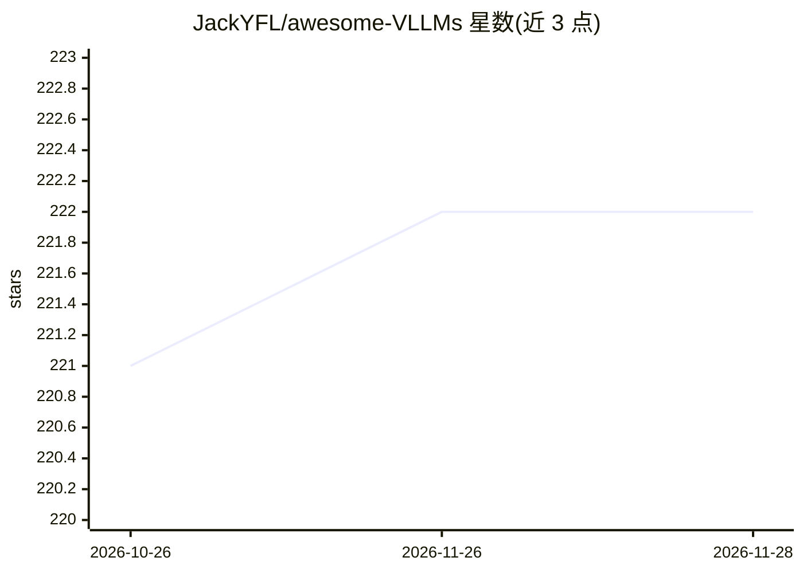

# JackYFL/awesome-VLLMs

⭐ 222 · 推送 2026-11-07 · [GitHub](https://github.com/JackYFL/awesome-VLLMs) · 组织维护

**视觉大语言模型（VLLM）应用论文清单，供研究者查阅**

以应用导向组织的视觉大语言模型文献汇总仓库，配套同名综述论文（arXiv:2501.02765）。条目按 Vision-to-text、MLLM surveys、复杂推理、视频理解、自动驾驶、医疗等类别以表格形式列出论文名称、发表场地、日期及代码/项目链接，并附目录索引。仓库以 PR 接受社区贡献，按日期在 News 区追加新条目，自 2024 年 12 月起持续更新。

## 筛选速览

| 维度 | 判定 | 备注 |
|---|---|---|
| AI 角色 | `ai-knowledge` | 知识聚合/清单类 |
| 许可风险 | `none` | — |
| 部署形态 | `None` |  |
| 模型依赖 | — | README 未给出锁定关系 |
| 硬件要求 | — | 无带数字的原话,不猜 |
| 安装摩擦 | `low` | 无编译、无系统依赖或容器化 |
| 成熟度 | — | 结构信号不足 |

## 能力要点

- 按应用方向分类的 VLLM/MLLM 论文表格，含 Venue、日期与代码链接
- 配套 arXiv 综述论文并提供 BibTeX 引用条目
- News 区按日期记录每次新增条目
- 接受社区 PR 贡献条目

## 适用场景

- 为视觉语言模型方向的文献调研查找论文与代码入口
- 跟踪 VLLM 复杂推理、视频理解等细分方向的最新论文
- 撰写相关综述时作为参考条目来源

## 场景标签

`科研工具` · 领域:学习与行业

## 证据(README 行号)

> L9: In this repository, we provide a comprehensive summary of the current literature from an application-oriented perspe
> L13: **If you think our paper is helpful for your research, you can cite through this bib tex entry!**

## 星数曲线

2026-10-26 221 → 2026-11-28 222（+1）

---
*卡片 v1 · prompt 1.4 · 生成 2026-11-25 · 置信度 high · 依据 README sha `d975c348e14c` · [字段定义](../../DATASET.md)*
