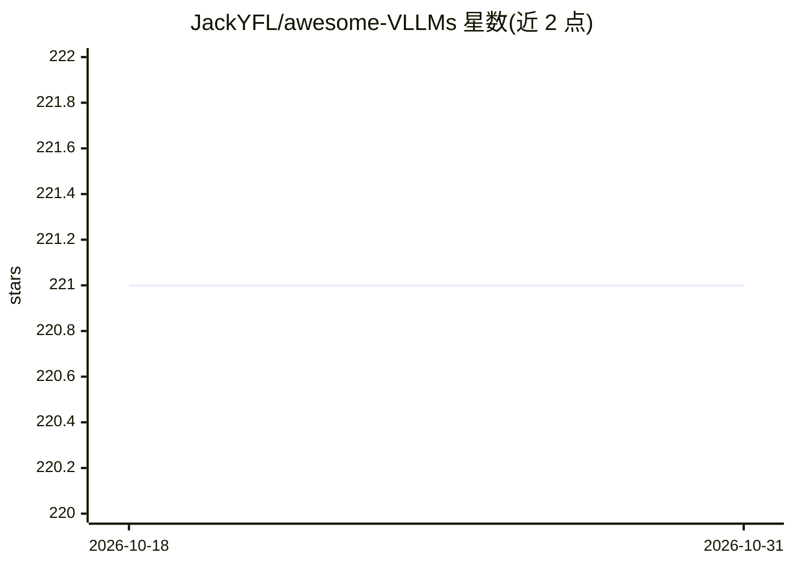

# JackYFL/awesome-VLLMs

⭐ 221 · 推送 2026-10-15 · [GitHub](https://github.com/JackYFL/awesome-VLLMs) · 组织维护

**视觉大语言模型（VLLM）应用方向的论文清单仓库**

配合综述论文《Visual Large Language Models for Generalized and Specialized Applications》（arXiv:2501.02765）维护的论文聚合清单：从应用视角（视觉转文本、指代理解等）收录 VLM/MLLM 相关论文与综述，条目含标题、发表 venue、日期、代码与项目链接，按类别组织，附更新日志（News）。面向 VLLM 研究者，接受社区 PR 与 BibTeX 引用，无软件安装与运行内容。

## 筛选速览

| 维度 | 判定 | 备注 |
|---|---|---|
| AI 角色 | `ai-knowledge` | 知识聚合/清单类 |
| 许可风险 | `none` | — |
| 部署形态 | `None` |  |
| 模型依赖 | — | README 未给出锁定关系 |
| 硬件要求 | — | 无带数字的原话,不猜 |
| 安装摩擦 | `low` | 无编译、无系统依赖或容器化 |
| 成熟度 | — | 结构信号不足 |

## 能力要点

- 按应用视角组织的 VLM/MLLM 论文与综述清单
- 条目含 venue、日期、代码与项目链接
- 由 2025 年 arXiv 综述论文（2501.02765）派生并持续更新

## 适用场景

- 查找视觉大语言模型各应用方向的论文
- 追踪 VLM 综述与新兴类别（复杂推理等）的更新
- 作为 VLLM 研究的文献参考入口

## 场景标签

`科研工具` `精选清单` · 领域:学习与行业

## 证据(README 行号)

> L9: In this repository, we provide a comprehensive summary of the current literature from an application-oriented perspe
> L18:   journal={arXiv preprint arXiv:2501.02765},

## 星数曲线

2026-10-18 221 → 2026-10-31 221（+0）

---
*卡片 v1 · prompt 1.4 · 生成 2026-10-22 · 置信度 high · 依据 README sha `5651e45809a4` · [字段定义](../../DATASET.md)*
