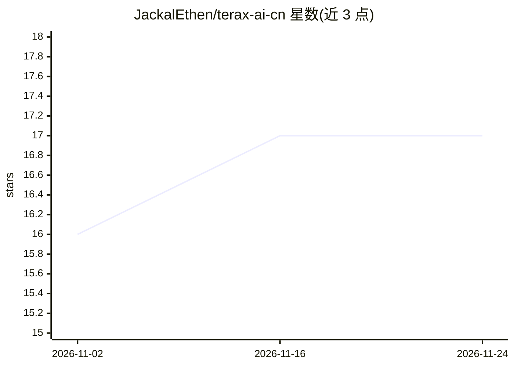

# JackalEthen/terax-ai-cn

⭐ 17 · TypeScript · Apache-2.0 · 推送 2026-10-20 · [GitHub](https://github.com/JackalEthen/terax-ai-cn) · 个人维护 · 中文 README

**Terax 中文汉化版：终端优先、带 AI 代理的轻量开发工作区**

Terax（原作者 Crynta）的简体中文汉化版本，基于 Tauri 2 + Rust + React 19 构建。功能包括 GPU 加速的块级终端（libghostty）与原生 PTY、CodeMirror 6 代码编辑器、源码管理面板（含 Git 图谱）、文件资源管理器与本地服务器网页预览。AI 部分提供代理侧边面板，支持自带密钥的多个提供商及 LM Studio/MLX/Ollama 本地推理，含内联补全、编辑差异对比与计划模式。打包体积约 7-8 MB，无遥测，无需账号。Windows/Linux 提供安装包，未做代码签名。

## 筛选速览

| 维度 | 判定 | 备注 |
|---|---|---|
| AI 角色 | `ai-enhanced` | 去掉 AI 部分产品仍成立 |
| 许可风险 | `permissive` | Apache-2.0 |
| 部署形态 | `desktop` | 安装包/桌面程序 |
| 模型依赖 | local-ok | 支持本地模型 |
| 硬件要求 | — | 无带数字的原话,不猜 |
| 安装摩擦 | `low` | 无编译、无系统依赖或容器化 |
| 成熟度 | — | 结构信号不足 |

## 能力要点

- 支持 OpenAI/Anthropic/Gemini/Groq/xAI/Cerebras/OpenRouter/DeepSeek/Mistral 及任意 OpenAI 兼容接口
- 本地推理支持 LM Studio、MLX、Ollama
- libghostty 块级终端 + 原生 PTY + Git 图谱源码管理
- 约 7-8 MB 打包体积，密钥存系统密钥链，无遥测

## 适用场景

- 在一个应用里完成终端操作、代码编辑与 Git 管理
- 通过侧边面板 AI 代理执行计划、文件编辑与命令任务
- 连接本地 Ollama/LM Studio 做离线补全与代理工作流

## 场景标签

`编码 Agent` `代码生成` · 领域:编码与开发

## 证据(README 行号)

> L4:  开源轻量级、终端优先的 AI 原生开发工作区 (ADE)
> L41: Terax 是一款开源轻量级、终端优先的 AI 原生开发环境 (ADE)，基于 Tauri 2 + Rust 和 React 19 构建。它将原生 PTY 后端与 GPU 加速的块级终端相结合，集成了 AI 代理侧边面板（支持自带

## 星数曲线

2026-11-02 16 → 2026-11-24 17（+1）

---
*卡片 v1 · prompt 1.4 · 生成 2026-11-18 · 置信度 mid · 依据 README sha `61728fdec02b` · [字段定义](../../DATASET.md)*
