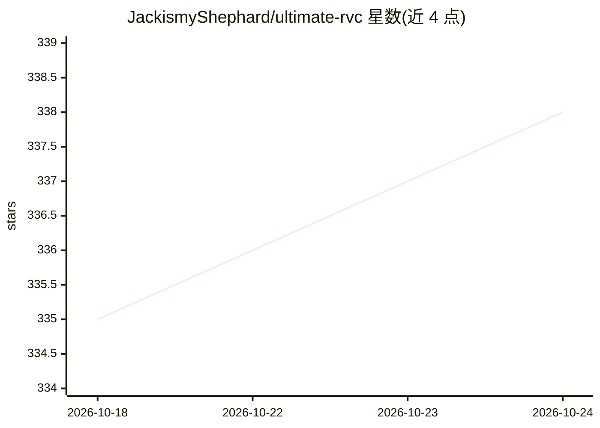

# JackismyShephard/ultimate-rvc

⭐ 338 · Python · MIT · 推送 2026-10-11 · [GitHub](https://github.com/JackismyShephard/ultimate-rvc) · 个人维护

**面向用户的 RVC 语音转换应用：生成歌曲翻唱与语音**

基于 Retrieval-based Voice Conversion (RVC) 的音频生成应用，是 AiCoverGen 的扩展。提供 Gradio Web 界面与 CLI，功能包括一键生成歌曲翻唱、从文本生成语音 (TTS)、自训练语音模型、人声提取与多种音高提取方法 (如 FCPE)、autotune 与降噪等前后处理，并带中间音频缓存与多步骤生成页。支持 Windows 与 Debian 系 Linux 本地安装（脚本安装，Linux 下装 CUDA 12.8），也提供 PyPI 包、Google Colab 与 Hugging Face Spaces 在线使用；CUDA 之外支持实验性 ROCm。面向想给 AI 助手/VTuber 加唱歌功能或让角色唱歌、读有声书的终端用户。

## 筛选速览

| 维度 | 判定 | 备注 |
|---|---|---|
| AI 角色 | `ai-native` | 本体是模型或模型工具 |
| 许可风险 | `permissive` | MIT |
| 部署形态 | `library` | 以包/库形式分发 |
| 模型依赖 | — | README 未给出锁定关系 |
| 硬件要求 | — | 无带数字的原话,不猜 |
| 安装摩擦 | `medium` | 含编译或系统依赖之一 |
| 成熟度 | — | 结构信号不足 |

## 能力要点

- 一键生成歌曲翻唱与 RVC 语音模型 TTS
- 内置语音模型训练套件与多种音高提取/前后处理选项
- 中间音频缓存降低重复推理时间，多步骤生成页可单步实验
- 提供 PyPI 包、CLI、Google Colab 与 Hugging Face Spaces 多种使用途径

## 适用场景

- 用喜欢的角色声音生成歌曲翻唱或朗读有声书
- 为自己的 AI 助手/聊天机器人/VTuber 加入唱歌功能
- 用自己的数据集训练 RVC 语音模型

## 场景标签

`语音合成` · 领域:内容生成

## 证据(README 行号)

> L8: An extension of AiCoverGen, which provides several new features and improvements, enabling users to generate audio-r
> L22: * TTS functionality, which allows you to generate speech from text using any RVC-based voice model. With this featu

## 星数曲线

2026-10-18 335 → 2026-10-24 338（+3）

---
*卡片 v1 · prompt 1.4 · 生成 2026-10-21 · 置信度 high · 依据 README sha `30b6609bba50` · [字段定义](../../DATASET.md)*
