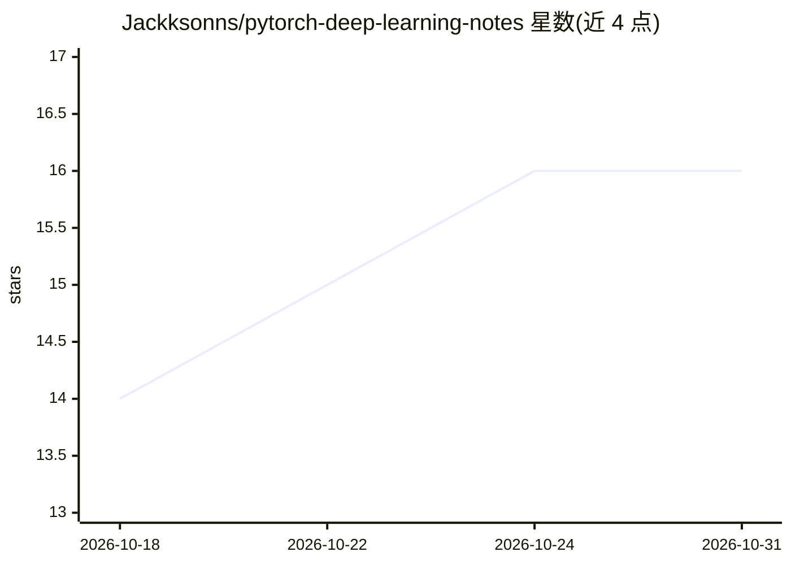

# Jackksonns/pytorch-deep-learning-notes

⭐ 16 · Python · MIT · 推送 2026-10-30 · [GitHub](https://github.com/Jackksonns/pytorch-deep-learning-notes) · 个人维护 · 中文 README

**面向新手的 PyTorch 深度学习学习笔记与可运行代码集合**

汇总 PyTorch 深度学习学习笔记与实现的代码仓库，内容参考李沐《动手学深度学习》与小土堆教程并加以改进，覆盖深度学习基础、LeNet/AlexNet/VGG/ResNet 等经典 CNN、图像分类/目标检测/语义分割等 CV 实战、Transformer 与 BERT 预训练微调、VAE、房价回归等模块。每个模块提供可直接运行的示例与注释，代码风格模块化便于二次开发。通过 Conda 建环境并 pip 安装依赖后按目录运行脚本，面向深度学习初学者与备赛者。

## 筛选速览

| 维度 | 判定 | 备注 |
|---|---|---|
| AI 角色 | `ai-knowledge` | 知识聚合/清单类 |
| 许可风险 | `permissive` | MIT |
| 部署形态 | `library` | 以包/库形式分发 |
| 模型依赖 | — | README 未给出锁定关系 |
| 硬件要求 | — | 无带数字的原话,不猜 |
| 安装摩擦 | `low` | 无编译、无系统依赖或容器化 |
| 成熟度 | — | 结构信号不足 |

## 能力要点

- 覆盖基础、经典 CNN、CV/NLP 实战与 BERT 微调等多模块代码
- 示例可直接运行并附详尽注释
- 提供 Conda 建环境与 pip 安装依赖的 Quick Start 流程

## 适用场景

- 初学深度学习时按模块跑通示例代码
- 做课程项目或 Kaggle 竞赛时参考迁移学习与检测实现
- 拿现成模版二次开发自己的训练流程

## 场景标签

`教程课程` · 领域:学习与行业

## 证据(README 行号)

> L8: 本仓库汇集了较为系统的 PyTorch 深度学习学习笔记与实现，包含较为完整的从基础神经网络到进阶架构与实战任务。代码参考并改进自李沐（Li Mu）的课程与小土堆的 PyTorch 教程，力求实现既简洁清晰又能直接运行的示例，便于学
> L10: 具体而言，内容涵盖深度学习基础、计算机视觉（CV）、自然语言处理（NLP）以及各类经典与前沿模型的实现。

## 星数曲线

2026-10-18 14 → 2026-10-31 16（+2）

---
*卡片 v1 · prompt 1.4 · 生成 2026-10-30 · 置信度 high · 依据 README sha `aef4bd7271c7` · [字段定义](../../DATASET.md)*
