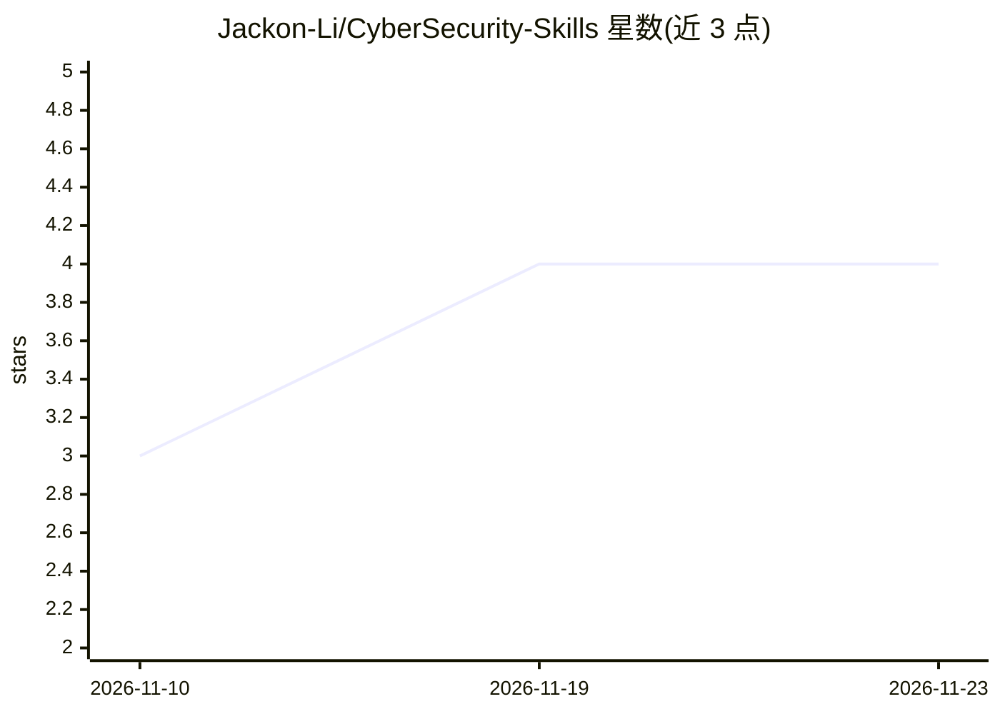

# Jackon-Li/CyberSecurity-Skills

⭐ 4 · Python · Apache-2.0 · 推送 2026-10-17 · [GitHub](https://github.com/Jackon-Li/CyberSecurity-Skills) · 个人维护 · 中文 README

**面向 AI 助手的 820 技能网络安全技能库（转载整理）**

本仓库是对上游 mukul975/Anthropic-Cybersecurity-Skills 的转载整理：820 个 SKILL.md 格式安全技能、34 个分类，覆盖渗透红队、检测响应、取证、云安全与合规治理。本仓库自身贡献为目录重排编号、生成含中文名的 index.json 索引、零依赖检索脚本 skill_query.py（Python 3.6+ 标准库）与 AGENT_USAGE.md 接入文档。技能内容一字未改，脚本未经审计，README 明确列出法律合规边界与授权要求。

## 筛选速览

| 维度 | 判定 | 备注 |
|---|---|---|
| AI 角色 | `ai-knowledge` | 知识聚合/清单类 |
| 许可风险 | `permissive` | Apache-2.0 |
| 部署形态 | `library` | 以包/库形式分发 |
| 模型依赖 | — | README 未给出锁定关系 |
| 硬件要求 | — | 无带数字的原话,不猜 |
| 安装摩擦 | `low` | 无编译、无系统依赖或容器化 |
| 成熟度 | — | 结构信号不足 |

## 能力要点

- 820 个技能按 34 个编号分类组织（红队 166/蓝队 547/取证 107）
- index.json 统一索引含中文名与 MITRE ATT&CK/NIST CSF 映射
- 零依赖检索脚本支持中文关键词、--team/--module 过滤
- 为 AI 助手提供'先检索再读取'的接入规范文档

## 适用场景

- 让 AI 助手按中文关键词检索并按需读取安全技能手册
- 红队项目按 --team red 拉取攻击链技能做行动规划参考
- SOC 告警研判与应急响应时查找处置剧本
- 按分类挑选技能做内部安全培训课程大纲

## 场景标签

`网络安全` `精选清单` · 领域:学习与行业

## 证据(README 行号)

> L3: **820 个面向 AI 助手的安全技能 · 34 个分类 · 转载整理**
> L53: 2. **索引生成** —— 从每个 `SKILL.md` 的 frontmatter 与正文中抽取字段，生成 `index.json`（820 条，每条含中文名、英文标识、领域、标签、路径）。

## 星数曲线

2026-11-10 3 → 2026-11-23 4（+1）

---
*卡片 v1 · prompt 1.4 · 生成 2026-11-21 · 置信度 mid · 依据 README sha `181e1f3a1149` · [字段定义](../../DATASET.md)*
