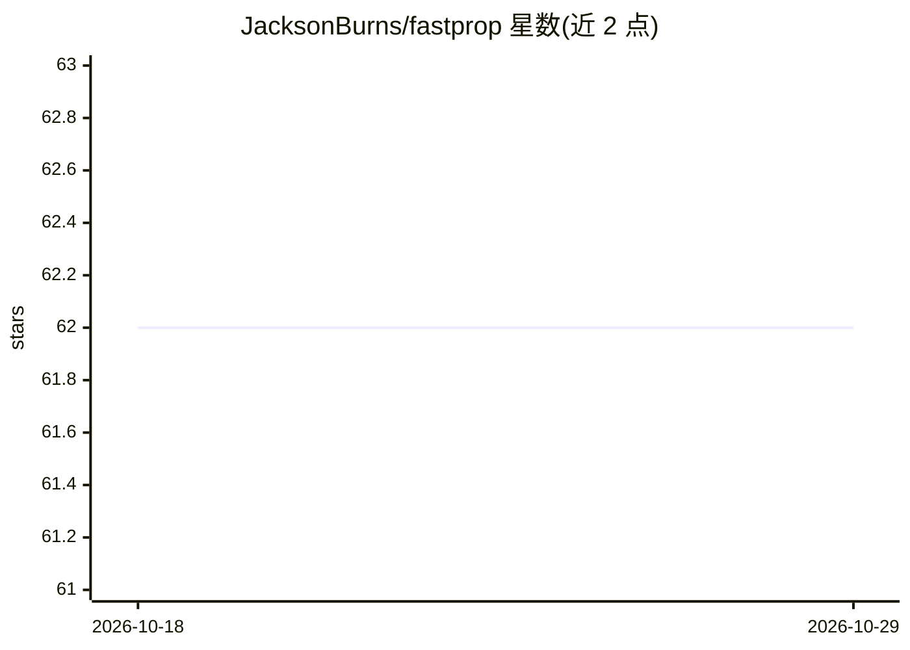

# JacksonBurns/fastprop

⭐ 62 · Python · MIT · 推送 2025-12-12 · [GitHub](https://github.com/JacksonBurns/fastprop) · [官网](https://jacksonburns.github.io/fastprop/) · 个人维护

**给化学研究者的分子性质预测库：SMILES 输入，FNN 训练**

面向化学/QSPR 场景的深度学习包：输入 SMILES 字符串列表，自动用 mordredcommunity 生成并缓存分子描述符，经预处理后训练 FNN 预测对应性质，代码量少于 500 行。流程分特征化、预处理、训练、预测四步；支持 CLI（train/predict/shap 子命令）与 Python 模块两种使用方式，支持回归/二分类/多分类/多标签任务，超参优化与 SHAP 分析为可选依赖。作者同时也是 Chemprop 的开发者，二者代码有共享；CLI 回归任务仅支持 MSE 损失。

## 筛选速览

| 维度 | 判定 | 备注 |
|---|---|---|
| AI 角色 | `ai-native` | 本体是模型或模型工具 |
| 许可风险 | `permissive` | MIT |
| 部署形态 | `library` | 以包/库形式分发 |
| 模型依赖 | — | README 未给出锁定关系 |
| 硬件要求 | — | 无带数字的原话,不猜 |
| 安装摩擦 | `low` | 无编译、无系统依赖或容器化 |
| 成熟度 | — | 结构信号不足 |

## 能力要点

- SMILES 输入自动生成 mordredcommunity 描述符并支持缓存
- 四步框架：特征化→预处理→FNN 训练→预测保存
- CLI 提供 train/predict/shap 子命令，另有 Python 模块接口
- 描述符计算默认使用全部 CPU，可用 MORDRED_NUM_PROC 环境变量调整

## 适用场景

- 用自有分子数据集训练性质预测模型
- 对给定 SMILES 批量预测分子性质
- 用 SHAP 分析模型中重要的分子描述符特征
- 复现 README 提供的 ADME、量子气味等基准研究

## 场景标签

`科研工具` · 领域:学习与行业

## 证据(README 行号)

> L45: `fastprop` is a package for performing deep-QSPR (Quantitative Structure-Property Relationship) with minimal user i
> L46: By passing in a list of SMILES strings, `fastprop` will automatically generate and cache a set of molecular descrip

## 星数曲线

2026-10-18 62 → 2026-10-29 62（+0）

---
*卡片 v1 · prompt 1.4 · 生成 2026-10-24 · 置信度 high · 依据 README sha `8fe15e61dcaa` · [字段定义](../../DATASET.md)*
