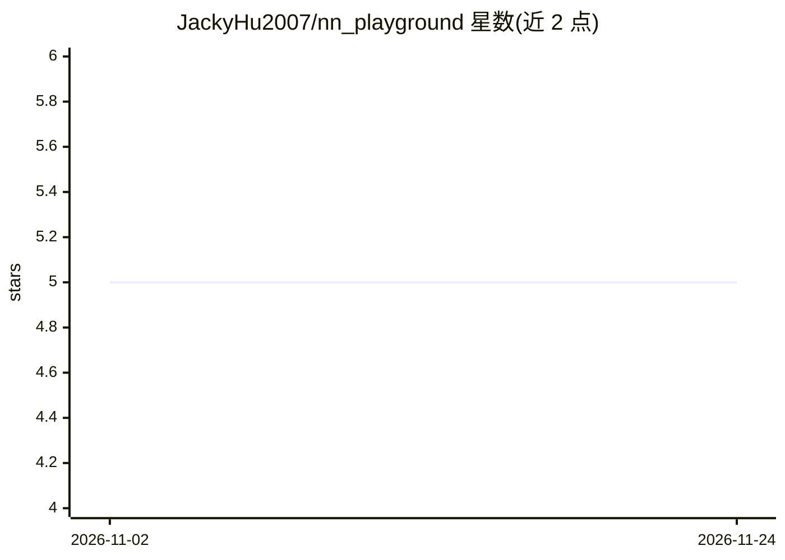

# JackyHu2007/nn_playground

⭐ 5 · Python · Apache-2.0 · 推送 2026-11-02 · [GitHub](https://github.com/JackyHu2007/nn_playground) · 个人维护

**可视化神经网络的交互式教学实验场：MoE/LayerNorm 数学原理**

对 TensorFlow Playground 的全栈重写：将网络计算移至纯 NumPy 的 Python 后端，通过 WebSockets 与原生 JS 前端实时通信。用户在浏览器中搭建并训练网络，支持 MoE（最多 16 专家、Top-k/Soft 路由、负载均衡辅助损失）、LayerNorm/RMSNorm、残差连接、梯度裁剪与 13 种激活函数，附带 KaTeX 渲染的数学推导教程与 70 余个合成/真实数据集。会话存内存、无持久化、仅 CPU 单线程，适用 ≤5 万点、≤12 隐藏层。

## 筛选速览

| 维度 | 判定 | 备注 |
|---|---|---|
| AI 角色 | `ai-native` | 本体是模型或模型工具 |
| 许可风险 | `permissive` | Apache-2.0 |
| 部署形态 | `library` | 以包/库形式分发 |
| 模型依赖 | — | README 未给出锁定关系 |
| 硬件要求 | — | 无带数字的原话,不猜 |
| 安装摩擦 | `low` | 无编译、无系统依赖或容器化 |
| 成熟度 | — | 结构信号不足 |

## 能力要点

- MoE 块构建：最多 16 专家、独立 1–8 隐藏层堆栈、Switch-Transformer 式负载均衡损失
- 自动导出为无依赖的独立 Python 函数
- 内置教程页：Jacobians/反向传播/MoE 路由数学推导（KaTeX）与使用指南
- 16+40+11 合成数据集及真实岩石/测井数据集，支持自定义 JSON 上传

## 适用场景

- 交互式理解 MoE 路由与归一化的数学机制
- 教学场景中演示梯度消失/爆炸与正则化效果
- 上传自己的小型分类或回归数据做可视化实验

## 场景标签

`教程课程` · 领域:学习与行业

## 证据(README 行号)

> L6: Unlike the original which runs entirely in the browser using TensorFlow.js, this version moves all neural network co
> L8: This is not just a toy—it is a rigorous, interactive laboratory designed to let you visualize, tweak, and understand
> L34: * **Interactive Tutorials**: A built-in tutorial page (`/tutorial.html`) featuring:

## 星数曲线

2026-11-02 5 → 2026-11-24 5（+0）

---
*卡片 v1 · prompt 1.4 · 生成 2026-11-21 · 置信度 high · 依据 README sha `a440df5ff940` · [字段定义](../../DATASET.md)*
