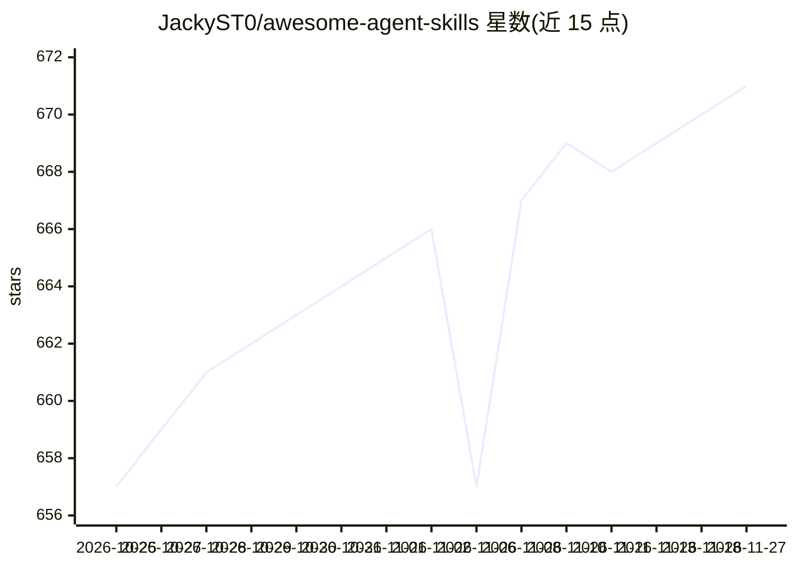

# JackyST0/awesome-agent-skills

⭐ 671 · JavaScript · CC0-1.0 · 推送 2026-11-26 · [GitHub](https://github.com/JackyST0/awesome-agent-skills) · [官网](https://jackyst0.github.io/awesome-agent-skills/) · 个人维护

**AI 编程工具的 Agent Skills 精选清单**

收录公开 GitHub 仓库中至少 512 stars 的 Agent Skills 与集合，按开发测试、效率任务、部署运维、数据处理、写作等用例分类组织，并标注所属平台、stars 数与来源。附安装脚本（macOS/Linux/Windows）将仓库自带的示例 skill 复制到 Cursor、Claude Code、Copilot、Windsurf、Codex、OpenCode、OpenClaw 等工具的技能目录；安装器仅安装 examples/ 目录中的示例，不管理清单内第三方项目。提供在线搜索页与使用指南。

## 筛选速览

| 维度 | 判定 | 备注 |
|---|---|---|
| AI 角色 | `ai-knowledge` | 知识聚合/清单类 |
| 许可风险 | `viral` | CC0-1.0 |
| 部署形态 | `None` |  |
| 模型依赖 | — | README 未给出锁定关系 |
| 硬件要求 | — | 无带数字的原话,不猜 |
| 安装摩擦 | `low` | 无编译、无系统依赖或容器化 |
| 成熟度 | — | 结构信号不足 |

## 能力要点

- 收录标准为 GitHub 仓库至少 512 stars，一/三方 skills 同标准
- 提供 curl/PowerShell 一键安装脚本与 checksum 校验流程
- 给出 7 个工具平台的全局与项目级技能目录对照表
- 提供 code-review、git-commit 等自带示例 skill

## 适用场景

- 为 Cursor 或 Claude Code 查找可安装的 agent 技能
- 按用途（调试、部署、写作）浏览社区 skills 集合
- 快速把示例 skill 装进本地编程工具的技能目录

## 场景标签

`精选清单` · 领域:学习与行业

## 证据(README 行号)

> L14: This catalog lists usable Agent Skills and collections from public GitHub repositories with **at least 512 stars**.
> L92: Agent Skills are instruction sets, scripts, and resources that AI agents can discover and use to perform specific t

## 星数曲线

2026-10-25 657 → 2026-11-27 671（+14）

---
*卡片 v1 · prompt 1.4 · 生成 2026-11-27 · 置信度 high · 依据 README sha `73125e8a81e8` · [字段定义](../../DATASET.md)*
