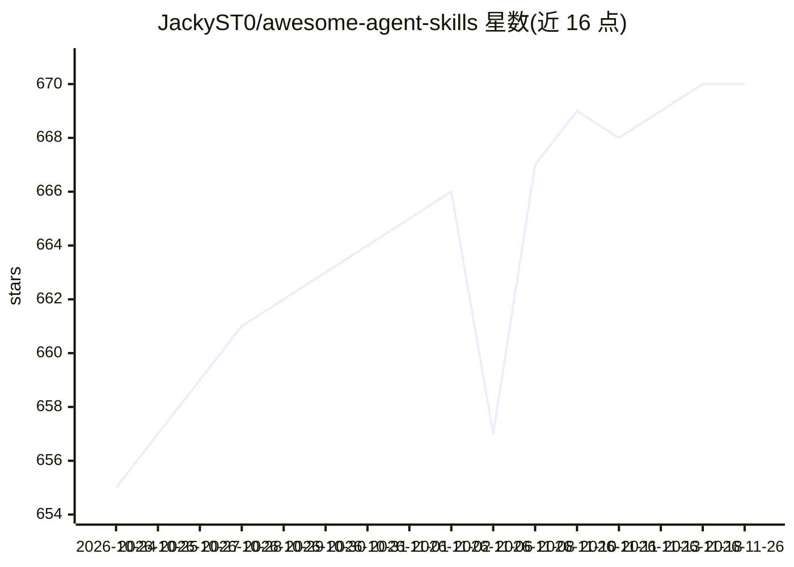

# JackyST0/awesome-agent-skills

⭐ 670 · JavaScript · CC0-1.0 · 推送 2026-11-25 · [GitHub](https://github.com/JackyST0/awesome-agent-skills) · [官网](https://jackyst0.github.io/awesome-agent-skills/) · 个人维护

**AI 编程助手的 Agent Skills 精选清单**

一个 awesome 形式的 Agent Skills 目录：按官方资源、技能集合、开发工具、生产力、DevOps、数据处理、写作、设计等分类收录技能条目与生态链接。附带 curl/PowerShell 安装脚本，将仓库 examples 目录中的示例技能复制到 Cursor、Claude Code、Copilot 等工具的技能目录；脚本仅安装本仓库自带示例，不管理清单中列出的第三方项目。面向使用 AI 编程工具、希望为工具加装技能的开发者。

## 筛选速览

| 维度 | 判定 | 备注 |
|---|---|---|
| AI 角色 | `ai-knowledge` | 知识聚合/清单类 |
| 许可风险 | `viral` | CC0-1.0 |
| 部署形态 | `library` | 以包/库形式分发 |
| 模型依赖 | — | README 未给出锁定关系 |
| 硬件要求 | — | 无带数字的原话,不猜 |
| 安装摩擦 | `low` | 无编译、无系统依赖或容器化 |
| 成熟度 | — | 结构信号不足 |

## 能力要点

- 按官方资源/开发工具/生产力/DevOps/数据处理/写作/设计等分类收录技能
- 提供 macOS/Linux 与 Windows PowerShell 安装脚本并附校验和验证流程
- 整理 7 个平台（Cursor、Claude Code、Copilot、Windsurf、Codex 等）的技能目录路径对照表
- 安装器仅安装仓库 examples 目录的示例技能

## 适用场景

- 为 Cursor 或 Claude Code 查找可安装的 Agent Skills
- 了解 Agent Skills 生态的规范、注册表与社区集合
- 参考各平台技能目录路径手动安装 SKILL.md

## 场景标签

`精选清单` · 领域:学习与行业

## 证据(README 行号)

> L1: # Awesome Agent Skills
> L10: > Modular instruction packages that give AI coding assistants on-demand capabilities for specific tasks, working ac

## 星数曲线

2026-10-24 655 → 2026-11-26 670（+15）

---
*卡片 v1 · prompt 1.4 · 生成 2026-11-26 · 置信度 mid · 依据 README sha `083139a24c96` · [字段定义](../../DATASET.md)*
