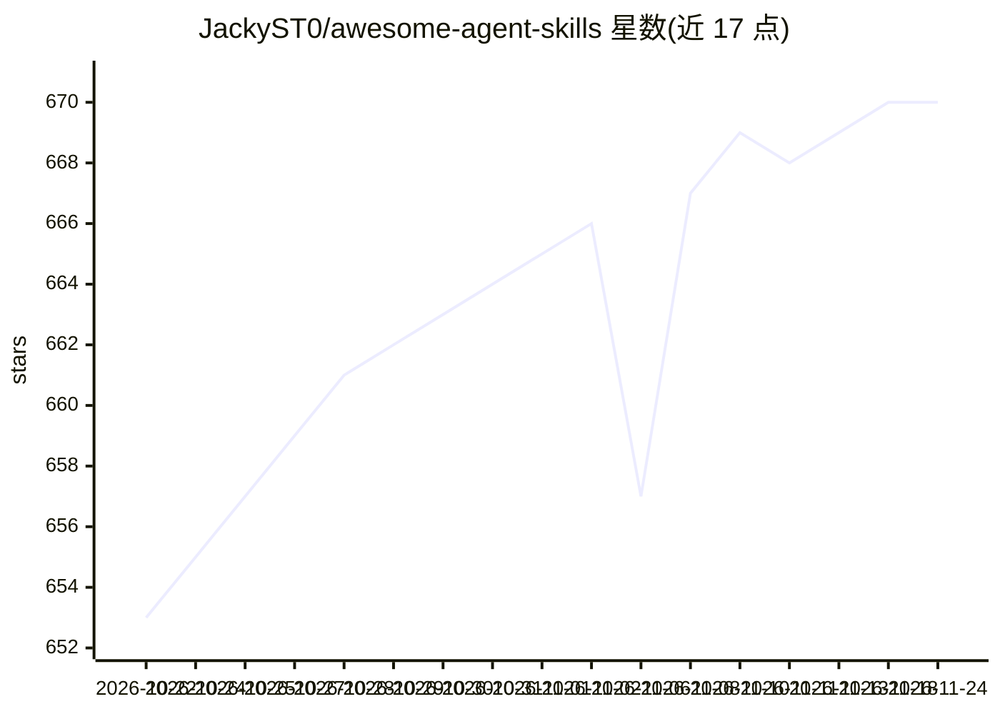

# JackyST0/awesome-agent-skills

⭐ 670 · JavaScript · CC0-1.0 · 推送 2026-11-16 · [GitHub](https://github.com/JackyST0/awesome-agent-skills) · [官网](https://jackyst0.github.io/awesome-agent-skills/) · 个人维护

**面向 AI 编程工具的 Agent Skills 精选清单**

一个精选（awesome）列表，收录可在 Cursor、Claude Code、GitHub Copilot 等 AI 编程工具中使用的 Agent Skills。条目按开发工具、效率、DevOps、数据处理、写作、设计等类别组织，每条附仓库链接与 Star 数。提供 curl/PowerShell 安装脚本（仅安装本仓库 examples/ 内的示例技能）、校验和验证流程与手动 git clone 安装方式，并收录官方规范、平台目录及社区技能集合链接。

## 筛选速览

| 维度 | 判定 | 备注 |
|---|---|---|
| AI 角色 | `ai-knowledge` | 知识聚合/清单类 |
| 许可风险 | `viral` | CC0-1.0 |
| 部署形态 | `library` | 以包/库形式分发 |
| 模型依赖 | — | README 未给出锁定关系 |
| 硬件要求 | — | 无带数字的原话,不猜 |
| 安装摩擦 | `low` | 无编译、无系统依赖或容器化 |
| 成熟度 | — | 结构信号不足 |

## 能力要点

- 提供 macOS/Linux/Windows 安装脚本，仅安装本仓库示例技能
- 列出 7 个平台的技能全局/项目目录路径（Cursor/Claude Code/Copilot/Windsurf/Codex/OpenCode/OpenClaw）
- 按开发工具、效率、DevOps、数据处理、写作、设计等类别组织条目
- 含 5 个示例技能模板与 SKILL.md 格式规范指引

## 适用场景

- 为 Cursor 或 Claude Code 查找特定任务的技能
- 安装示例技能模板开始编写自己的 Skill
- 了解 Agent Skills 生态的规范与社区集合

## 场景标签

`精选清单` · 领域:学习与行业

## 证据(README 行号)

> L10: > Modular instruction packages that give AI coding assistants on-demand capabilities for specific tasks, working ac
> L14: ## Contents
> L53: > Note: The installer only installs the bundled example skills from this repository's `examples/` directory. It is 

## 星数曲线

2026-10-22 653 → 2026-11-24 670（+17）

---
*卡片 v1 · prompt 1.4 · 生成 2026-11-24 · 置信度 mid · 依据 README sha `bc53194dbaa8` · [字段定义](../../DATASET.md)*
