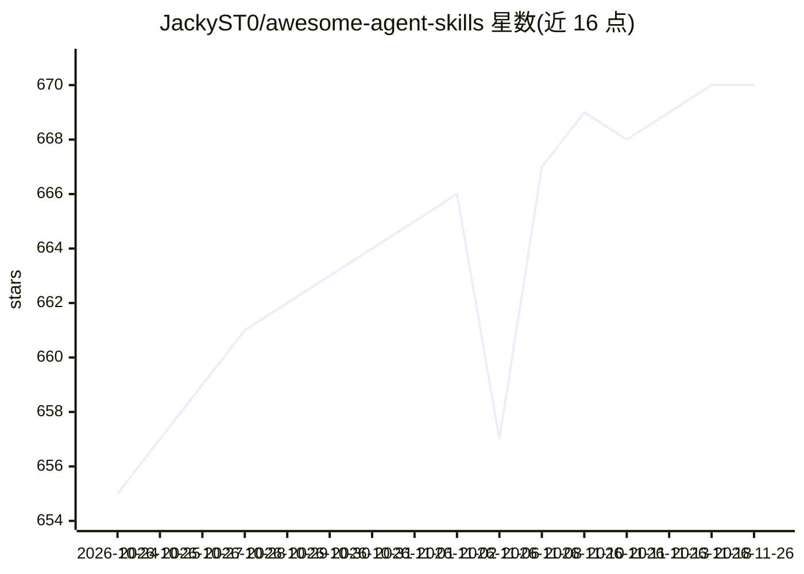

# JackyST0/awesome-agent-skills

⭐ 670 · JavaScript · CC0-1.0 · 推送 2026-11-25 · [GitHub](https://github.com/JackyST0/awesome-agent-skills) · [官网](https://jackyst0.github.io/awesome-agent-skills/) · 个人维护 · 中文 README

**面向 AI 编程工具用户的 Agent Skills 精选清单与安装器**

以 SKILL.md 格式组织 AI Agent 技能的策展清单，覆盖开发工具、生产力、DevOps、数据处理、写作、设计等类别，并附官方规范、官方资源与其他技能合集的链接。提供跨平台安装脚本（macOS/Linux shell 与 Windows PowerShell），带校验和验证流程，也可通过 git clone 手动安装；安装器仅安装仓库 examples/ 目录中的示例技能，不是第三方项目的包管理器。README 标注支持 Cursor、Claude Code、Copilot、Windsurf、Codex、OpenCode、OpenClaw 等平台的全局与项目目录。

## 筛选速览

| 维度 | 判定 | 备注 |
|---|---|---|
| AI 角色 | `ai-knowledge` | 知识聚合/清单类 |
| 许可风险 | `viral` | CC0-1.0 |
| 部署形态 | `library` | 以包/库形式分发 |
| 模型依赖 | — | README 未给出锁定关系 |
| 硬件要求 | — | 无带数字的原话,不猜 |
| 安装摩擦 | `low` | 无编译、无系统依赖或容器化 |
| 成熟度 | — | 结构信号不足 |

## 能力要点

- 跨 7 个平台的技能目录约定（Cursor/Claude Code/Copilot/Windsurf/Codex/OpenCode/OpenClaw）
- 提供带校验和验证的跨平台安装脚本与手动 git clone 方式
- 按开发工具、生产力、DevOps、数据处理、写作、设计等类别组织技能条目
- 附 5 个示例技能模板与 SKILL.md 规范链接

## 适用场景

- 为 Cursor 或 Claude Code 查找和安装现成的 Agent 技能
- 按照 SKILL.md 规范创建自己的技能
- 了解 Agent Skills 生态的官方规范与社区合集

## 场景标签

`精选清单` · 领域:学习与行业

## 证据(README 行号)

> L10: > Modular instruction packages that give AI coding assistants on-demand capabilities for specific tasks, working ac
> L53: > Note: The installer only installs the bundled example skills from this repository's `examples/` directory. It is 
> L70: Agent Skills are instruction sets, scripts, and resources that AI agents can discover and use to perform specific t

## 星数曲线

2026-10-24 655 → 2026-11-26 670（+15）

---
*卡片 v1 · prompt 1.4 · 生成 2026-11-25 · 置信度 mid · 依据 README sha `ca80070c2996` · [字段定义](../../DATASET.md)*
