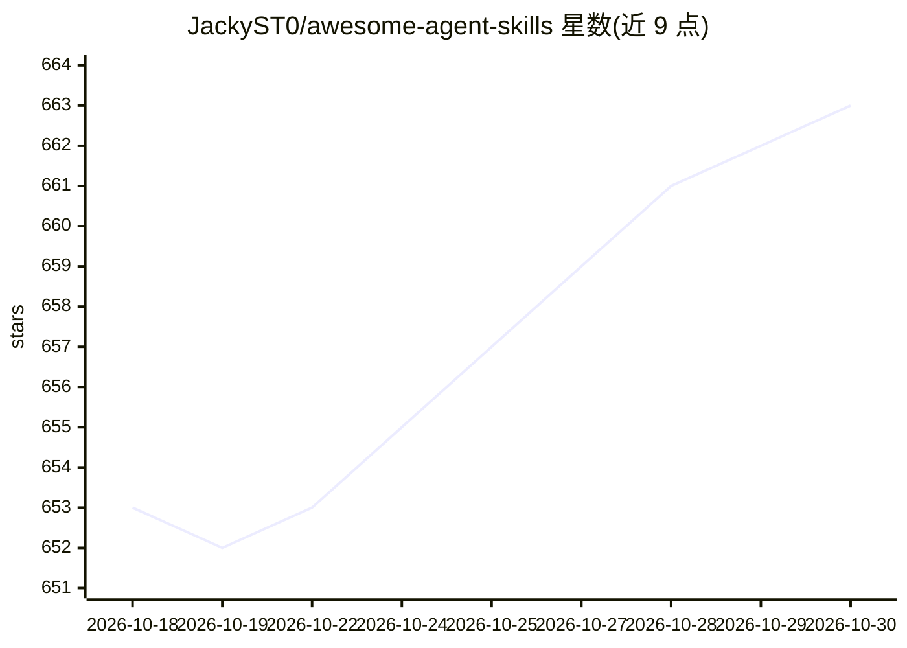

# JackyST0/awesome-agent-skills

⭐ 663 · JavaScript · CC0-1.0 · 推送 2026-10-28 · [GitHub](https://github.com/JackyST0/awesome-agent-skills) · [官网](https://jackyst0.github.io/awesome-agent-skills/) · 个人维护 · 中文 README

**面向 AI 编程工具的 Agent Skills 策展清单**

精选 Agent Skills（含 SKILL.md 格式的指令包）的 awesome 清单：收录官方规范与资源、技能合集、开发工具与生产力技能等条目，按类别组织，并说明 Cursor、Claude Code、Copilot、Windsurf、Codex 等各平台的技能目录位置。提供 curl/PowerShell 一键安装脚本（仅安装本仓库 examples/ 内示例技能，非第三方技能包管理器），支持校验和验证与 git clone 手动安装。限制：安装器不管理清单中列出的第三方项目。

## 筛选速览

| 维度 | 判定 | 备注 |
|---|---|---|
| AI 角色 | `ai-knowledge` | 知识聚合/清单类 |
| 许可风险 | `viral` | CC0-1.0 |
| 部署形态 | `library` | 以包/库形式分发 |
| 模型依赖 | — | README 未给出锁定关系 |
| 硬件要求 | — | 无带数字的原话,不猜 |
| 安装摩擦 | `low` | 无编译、无系统依赖或容器化 |
| 成熟度 | — | 结构信号不足 |

## 能力要点

- 收录官方 Agent Skills 规范、资源仓库与社区技能合集
- 列出 8 个平台（Cursor/Claude Code/Copilot/Windsurf/Codex 等）的技能目录路径
- 提供带校验和验证的一键安装脚本（macOS/Linux 与 Windows）

## 适用场景

- 为 Cursor、Claude Code 等 AI 编程工具查找可用的技能包
- 了解 Agent Skills 的官方规范与各平台安装位置
- 按开发工具、生产力等类别浏览社区技能生态

## 场景标签

`精选清单` · 领域:学习与行业

## 证据(README 行号)

> L10: > Modular instruction packages that give AI coding assistants on-demand capabilities for specific tasks, working ac
> L70: Agent Skills are instruction sets, scripts, and resources that AI agents can discover and use to perform specific t

## 星数曲线

2026-10-18 653 → 2026-10-30 663（+10）

---
*卡片 v1 · prompt 1.4 · 生成 2026-10-21 · 置信度 mid · 依据 README sha `f4923e178a42` · [字段定义](../../DATASET.md)*
