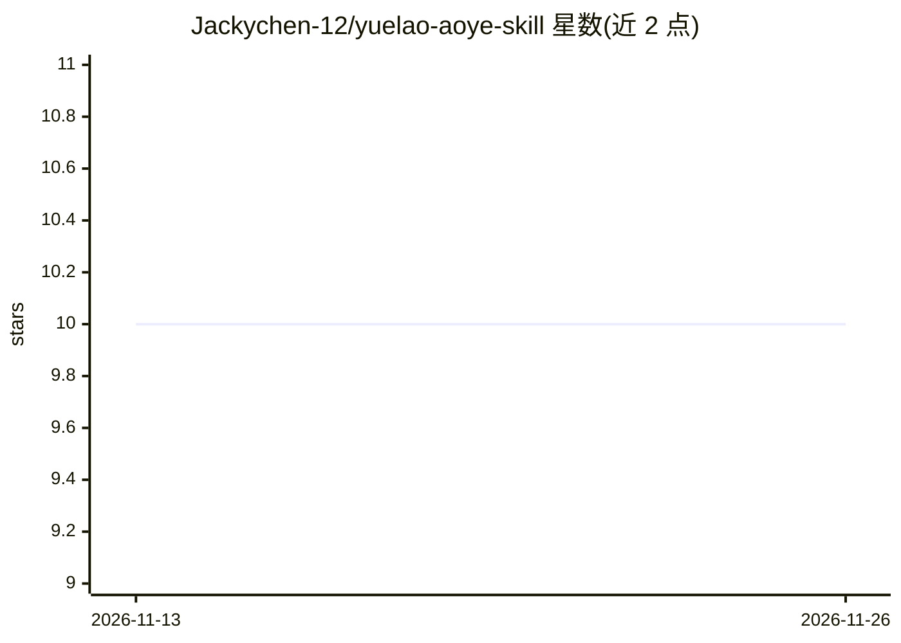

# Jackychen-12/yuelao-aoye-skill

⭐ 10 · HTML · MIT · 推送 2026-08-25 · [GitHub](https://github.com/Jackychen-12/yuelao-aoye-skill) · 个人维护 · 中文 README

**婚恋条件定位报告的 Claude Agent Skill：分步问答后输出画像匹配**

以纯 Markdown 驱动的 Agent Skill，无 Python 脚本、无 pip、无 API key、零联网。用户按提示分轮报出条件（男生先问城市收入、女生先打颜值），skill 按「普通人 4 分、从低往加、颜值与家境两轴独立」等内置元规则生成评分与梯队定位，落盘为浅色单文件 HTML 报告，含上限画像/下限画像双卡与两条可执行建议。安装方式为 clone 到 Claude Code 的 skills 目录。README 自述为娱乐性质工具，不构成专业建议。

## 筛选速览

| 维度 | 判定 | 备注 |
|---|---|---|
| AI 角色 | `ai-native` | 本体是模型或模型工具 |
| 许可风险 | `permissive` | MIT |
| 部署形态 | `None` |  |
| 模型依赖 | — | README 未给出锁定关系 |
| 硬件要求 | — | 无带数字的原话,不猜 |
| 安装摩擦 | `low` | 无编译、无系统依赖或容器化 |
| 成熟度 | — | 结构信号不足 |

## 能力要点

- 纯 Markdown 驱动，零依赖、零联网、零安装
- 男生/女生两套互不通用的评分流程，颜值轴与家境轴独立打分
- 生成浅色单文件 HTML 报告（上限/下限双画像 + 两条路子），双击即开
- 主控 SKILL.md 250 行，语料按阶段按需加载

## 适用场景

- 相亲前想对自己在婚恋市场的定位做一份推演报告
- 让 AI 按固定评分尺度给自己条件打分并给出可执行的择偶策略
- 想体验特定人设风格的婚恋问答对话

## 场景标签

`聊天机器人` `AI 助手` · 领域:对话与助手

## 证据(README 行号)

> L3: **一个 Agent Skill：一步步报条件 → 被扎醒 → 拿走一份能存下来的婚恋市场定位判决书**
> L31: > 全程零依赖、零联网、零安装。没有 Python 脚本，没有 pip，没有 API key——纯 Markdown 驱动的 skill。

## 星数曲线

2026-11-13 10 → 2026-11-26 10（+0）

---
*卡片 v1 · prompt 1.4 · 生成 2026-11-20 · 置信度 high · 依据 README sha `5f87d099b703` · [字段定义](../../DATASET.md)*
