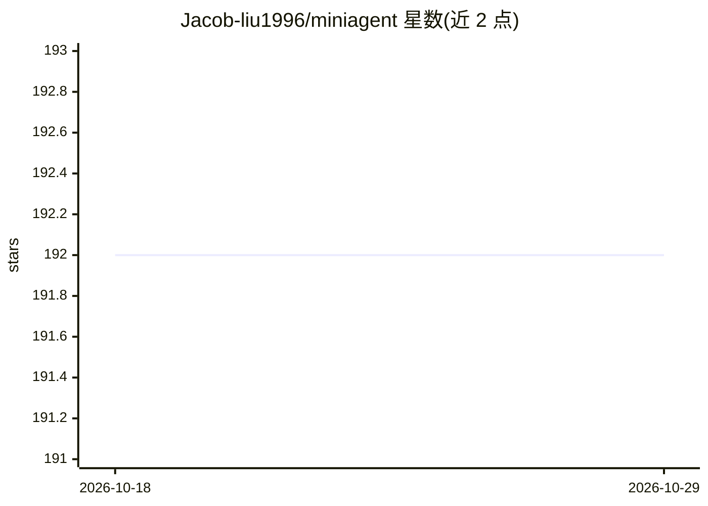

# Jacob-liu1996/miniagent

⭐ 192 · Python · MIT · 推送 2026-10-08 · [GitHub](https://github.com/Jacob-liu1996/miniagent) · [官网](https://github.com/Jacob-liu1996/miniagent) · 个人维护 · 中文 README

**给开发者的轻量级 ReAct 智能代理框架（约400行核心代码）**

用约 400 行 Python 代码实现完整 ReAct（推理-行动）循环与工具调用机制的智能代理框架，面向希望理解智能代理核心概念与实现原理的开发者。提供消息/记忆系统、插件式工具架构、基于异步编程的 LLM 接口（SimpleLLM），支持文件操作、Python 代码执行、命令行运行、数据处理等任务，并可选集成 Parallel Search MCP 实现网页搜索。安装需克隆仓库并 pip 安装依赖，运行需 OpenAI API Key（Python 3.8+）。核心定位是教学友好与可扩展的基础平台，而非生产级框架。

## 筛选速览

| 维度 | 判定 | 备注 |
|---|---|---|
| AI 角色 | `ai-ecosystem` | LLM/agent 周边工具 |
| 许可风险 | `permissive` | MIT |
| 部署形态 | `library` | 以包/库形式分发 |
| 模型依赖 | — | README 未给出锁定关系 |
| 硬件要求 | — | 无带数字的原话,不猜 |
| 安装摩擦 | `low` | 无编译、无系统依赖或容器化 |
| 成熟度 | — | 结构信号不足 |

## 能力要点

- 完整实现 ReAct 推理-行动循环
- 插件式可扩展工具系统与异步编程架构
- 约 400 行核心代码，依赖极简，注释与示例丰富
- 可选 Parallel Search MCP 网页搜索集成（Python 3.10+）

## 适用场景

- 学习智能代理 ReAct 模式的核心实现原理
- 在其基础上扩展自定义工具构建代理应用
- 通过对话执行文件操作、代码执行与命令行任务

## 场景标签

`Agent 框架` `教程课程` · 领域:Agent 开发

## 证据(README 行号)

> L14: MiniAgent 是一个轻量级的智能代理框架，实现了完整的 ReAct（推理-行动）模式和工具调用机制。项目采用简洁的架构设计，用约400行代码提供了智能代理的核心功能。这个项目旨在帮助开发者快速理解智能代理的核心概念和实现原理
> L79: ├── llm.py             # LLM接口 (SimpleLLM)

## 星数曲线

2026-10-18 192 → 2026-10-29 192（+0）

---
*卡片 v1 · prompt 1.4 · 生成 2026-10-22 · 置信度 mid · 依据 README sha `1d0b782dad68` · [字段定义](../../DATASET.md)*
