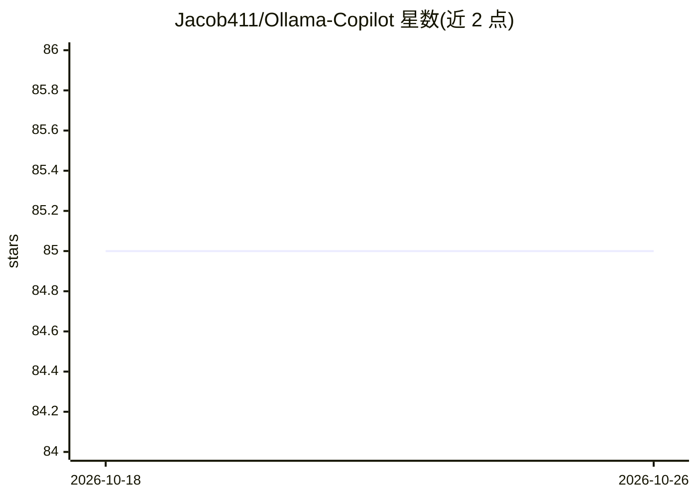

# Jacob411/Ollama-Copilot

⭐ 85 · Python · 推送 2025-12-03 · [GitHub](https://github.com/Jacob411/Ollama-Copilot) · 个人维护

**把 Ollama 模型接入 Neovim 的 Copilot 式代码补全插件**

Neovim 插件，附带一个基于 Python（pygls）的语言服务器，从本地 Ollama 模型读取代码补全输出，以 ghost text 形式插入编辑器，支持流式实时生成。通过 textChange 事件触发并用防抖控制请求频率以降低 CPU 占用；LSP capabilities 可自动检测（兼容 nvim-cmp，也可不依赖它）。面向使用本地 Ollama 的 Neovim 用户，需先安装 Ollama 并拉取模型；README 建议使用 3B 以下参数模型（deepseek-coder 1.3B、starcoder 等）以获得低延迟。

## 筛选速览

| 维度 | 判定 | 备注 |
|---|---|---|
| AI 角色 | `ai-ecosystem` | LLM/agent 周边工具 |
| 许可风险 | `none` | — |
| 部署形态 | `library` | 以包/库形式分发 |
| 模型依赖 | local-ok | 支持本地模型 |
| 硬件要求 | — | 无带数字的原话,不猜 |
| 安装摩擦 | `low` | 无编译、无系统依赖或容器化 |
| 成熟度 | — | 结构信号不足 |

## 能力要点

- Ollama 模型驱动的 ghost text 补全，支持流式生成
- 基于 pygls 的 Python 语言服务器，attach 后经 :LspInfo 可查看
- textChange 触发加请求防抖，控制 CPU 占用
- LSP capabilities 自动检测，nvim-cmp 为可选依赖

## 适用场景

- 在 Neovim 中用本地模型获得 Copilot 式 Tab 补全
- 离线环境下进行代码补全
- 替换云端补全服务，用本地小模型实现低延迟补全

## 场景标签

`代码生成` · 领域:编码与开发

## 证据(README 行号)

> L6: Ollama Copilot allows users to integrate their Ollama code completion models into Neovim, giving GitHub Copilot-like
> L14: - [x] Language server which can provide code completions from an Ollama model
> L20: To use Ollama-Copilot, you need to have Ollama installed github.com/ollama/ollama:

## 星数曲线

2026-10-18 85 → 2026-10-26 85（+0）

---
*卡片 v1 · prompt 1.4 · 生成 2026-10-24 · 置信度 mid · 依据 README sha `eb846f1f15d3` · [字段定义](../../DATASET.md)*
