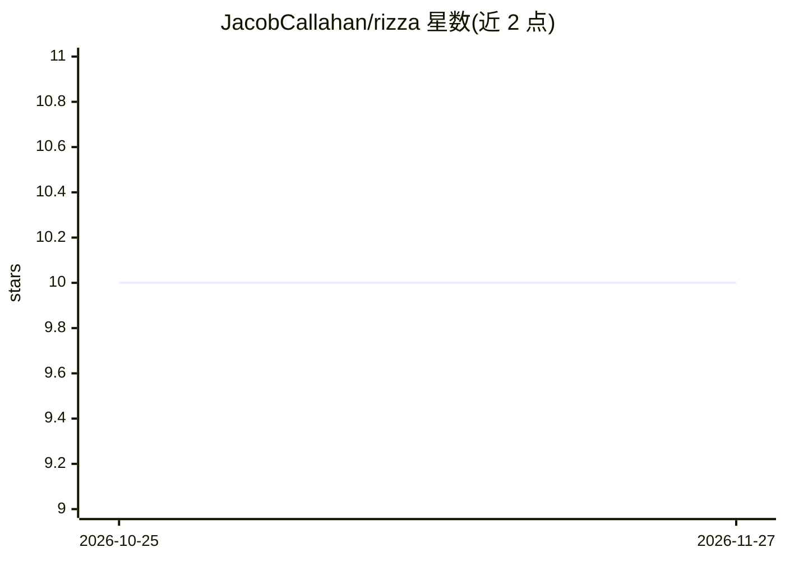

# JacobCallahan/rizza

⭐ 10 · Python · NOASSERTION · 推送 2026-07-31 · [GitHub](https://github.com/JacobCallahan/rizza) · 个人维护

**用遗传算法自动探索并测试 RH Satellite API 的工具**

面向 Red Hat Satellite 的自动化测试工具：通过遗传算法进化出成功（或刻意失败）的 API 调用，默认覆盖全部实体中尚无通过测试的方法，异步执行，完成的测试保存至本地数据目录；validate 子命令重跑已存测试并生成含请求值与响应的结构化 YAML 报告。配置采用 picoconf .pconf 文件，支持环境变量运行时覆盖，可在 Docker 中构建或拉取镜像运行，要求 Python 3.10+。

## 筛选速览

| 维度 | 判定 | 备注 |
|---|---|---|
| AI 角色 | `ai-enhanced` | 去掉 AI 部分产品仍成立 |
| 许可风险 | `none` | NOASSERTION |
| 部署形态 | `self-host` | docker 或自建部署 |
| 模型依赖 | — | README 未给出锁定关系 |
| 硬件要求 | — | 无带数字的原话,不猜 |
| 安装摩擦 | `low` | 无编译、无系统依赖或容器化 |
| 成熟度 | — | 结构信号不足 |

## 能力要点

- 遗传算法驱动 API 调用探索，支持 _all/_new/_specific 实体与方法粒度
- validate 重跑保存的测试并自动生成结构化验证报告
- .pconf 配置文件 + 环境变量运行时覆盖
- 提供 Dockerfile 与可拉取镜像

## 适用场景

- 为 Satellite 的各类 API 实体自动生成并积累可回归的测试
- 升级后批量重跑历史测试确认接口仍可用
- 通过配置调整种群与代数等遗传算法参数做探索实验

## 场景标签

 · 领域:软件测试/自动化

## 证据(README 行号)

> L2: An increasingly intelligent method to test RH Satellite.
> L66: Uses a genetic algorithm to evolve toward a successful (or deliberately failing) API call for a given entity and me

## 星数曲线

2026-10-25 10 → 2026-11-27 10（+0）

---
*卡片 v1 · prompt 1.4 · 生成 2026-11-20 · 置信度 high · 依据 README sha `87385be84f07` · [字段定义](../../DATASET.md)*
