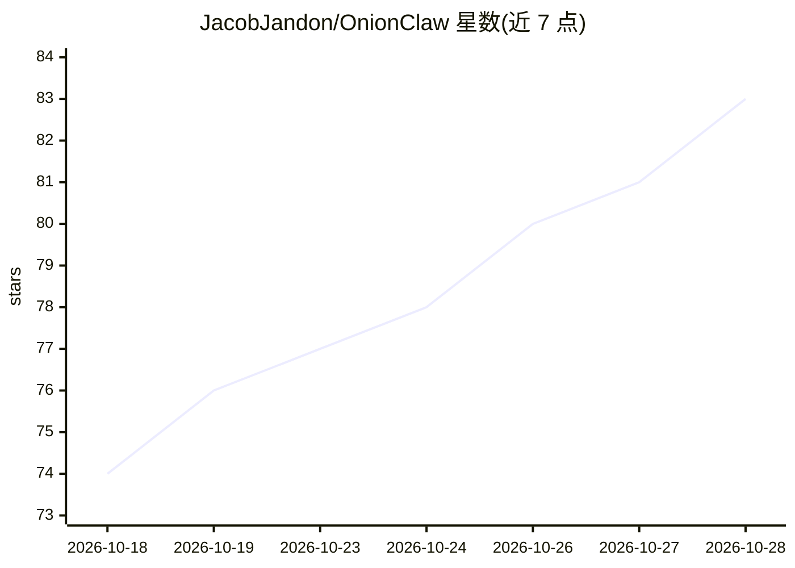

# JacobJandon/OnionClaw

⭐ 85 · Python · NOASSERTION · 推送 2026-10-27 · [GitHub](https://github.com/JacobJandon/OnionClaw) · [官网](https://github.com/JacobJandon/OnionClaw) · 个人维护

**供 AI agent 与终端使用的 Tor 暗网访问与 OSINT 工具集**

以 OpenClaw skill 形式提供、也可独立于任何终端运行的 Tor 暗网工具：7 个命令覆盖 Tor 连通检测、身份轮换、18 个暗网搜索引擎聚合检索、.onion 页面抓取、LLM OSINT 分析（4 种模式）与一键调查流水线。基于 SICRY 引擎，流水线中仅查询精炼、结果过滤与报告生成三步使用 LLM，其余步骤无 LLM key 也可运行。面向防御性研究、红队与威胁情报场景，README 明确讨论双用途风险与司法管辖问题。运行需本地 Tor（SOCKS 127.0.0.1:9050）与 Python 3.10+。

## 筛选速览

| 维度 | 判定 | 备注 |
|---|---|---|
| AI 角色 | `ai-enhanced` | 去掉 AI 部分产品仍成立 |
| 许可风险 | `permissive` | NOASSERTION |
| 部署形态 | `library` | 以包/库形式分发 |
| 模型依赖 | local-ok | 支持本地模型 |
| 硬件要求 | — | 无带数字的原话,不猜 |
| 安装摩擦 | `low` | 无编译、无系统依赖或容器化 |
| 成熟度 | — | 结构信号不足 |

## 能力要点

- 聚合 18 个暗网搜索引擎并返回去重结果
- pipeline.py 一键完成 检测→搜索→过滤→抓取→LLM 分析 流水线
- Tor 身份轮换（renew.py）与 .onion 页面抓取（最多 8000 字符）
- 多数命令无需 LLM key，可配置 Ollama 做完全本地推理

## 适用场景

- 安全研究人员监控勒索组织与泄露论坛的暗网动态
- 红队/威胁情报工作中对 .onion 站点做自动抓取与 LLM 分析
- 让 OpenClaw agent 在会话中直接检索和抓取暗网内容
- 检查自身数据是否出现在暗网泄露看板

## 场景标签

`网络安全` `网页抓取` · 领域:效率与自动化

## 证据(README 行号)

> L13: OnionClaw gives AI agents full access to the Tor network and .onion hidden services. It runs as an OpenClaw skill (
> L286: **Steps 1–6 work fully without an LLM key.** Only steps 3, 5, and 7 use the LLM — they fall back gracefully when n

## 星数曲线

2026-10-18 74 → 2026-10-28 83（+9）

---
*卡片 v1 · prompt 1.4 · 生成 2026-10-24 · 置信度 high · 依据 README sha `6b8f92cba114` · [字段定义](../../DATASET.md)*
