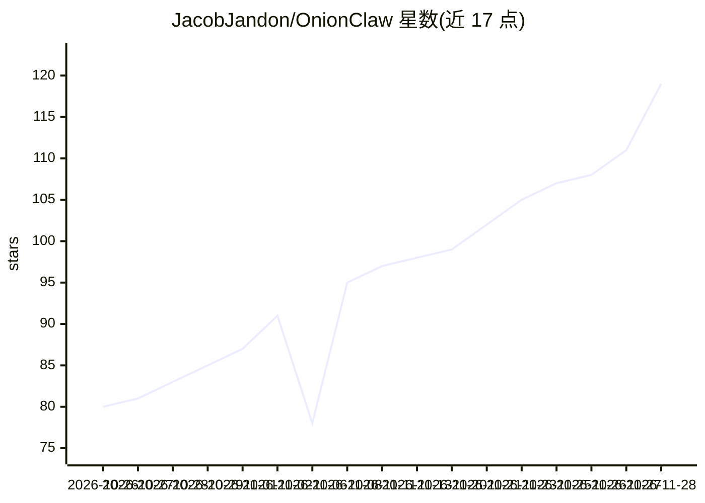

# JacobJandon/OnionClaw

⭐ 119 · Python · NOASSERTION · 推送 2026-11-12 · [GitHub](https://github.com/JacobJandon/OnionClaw) · [官网](https://github.com/JacobJandon/OnionClaw) · 个人维护

**给 AI agent 提供 Tor 暗网访问能力的 OpenClaw 技能**

OnionClaw 以 OpenClaw 技能和独立命令行两种形式提供 Tor 网络与 .onion 隐藏服务访问：7 个脚本覆盖 Tor 状态检查、线路/身份轮换、17 个暗网搜索引擎检索、页面抓取、LLM OSINT 分析（4 种模式）以及自动化 Robin 流水线（精炼查询→多引擎检索→过滤→批量抓取→分析）。基于 SICRY 引擎，面向 OSINT、威胁情报与安全研究用途；LLM key 可选，可通过本地 Ollama 实现无 key 的本地推理；README 明确讨论双用途风险并要求使用者自行承担法律合规责任。

## 筛选速览

| 维度 | 判定 | 备注 |
|---|---|---|
| AI 角色 | `ai-ecosystem` | LLM/agent 周边工具 |
| 许可风险 | `permissive` | NOASSERTION |
| 部署形态 | `library` | 以包/库形式分发 |
| 模型依赖 | local-ok | 支持本地模型 |
| 硬件要求 | — | 无带数字的原话,不猜 |
| 安装摩擦 | `low` | 无编译、无系统依赖或容器化 |
| 成熟度 | — | 结构信号不足 |

## 能力要点

- 7 个命令覆盖 Tor 检查、身份轮换、17 引擎暗网搜索、抓取与 OSINT 流水线
- LLM 分析可选：无 key 时 7 个命令中 5 个可完整运行，或配置本地 Ollama 推理
- pipeline.py 一条命令完成查询精炼→搜索→过滤→并发抓取→报告的自动化流程
- 捆绑 SICRY 引擎并提供 sync_sicry.py 增量同步

## 适用场景

- 对勒索软件博客、漏洞市场等暗网信息源做持续威胁情报监控
- 监控泄露板与 paste 站点上与自身域名/API key 相关的凭据泄露
- 安全研究中批量抓取 .onion 服务页面并生成 OSINT 分析报告

## 场景标签

`网络安全` · 领域:学习与行业

## 证据(README 行号)

> L11: > **OpenClaw skill + standalone tool** — full Tor / dark web access for AI agents
> L13: OnionClaw gives AI agents full access to the Tor network and .onion hidden services. It runs as an OpenClaw skill (

## 星数曲线

2026-10-26 80 → 2026-11-28 119（+39）

---
*卡片 v1 · prompt 1.4 · 生成 2026-11-28 · 置信度 mid · 依据 README sha `ea31e1f61564` · [字段定义](../../DATASET.md)*
