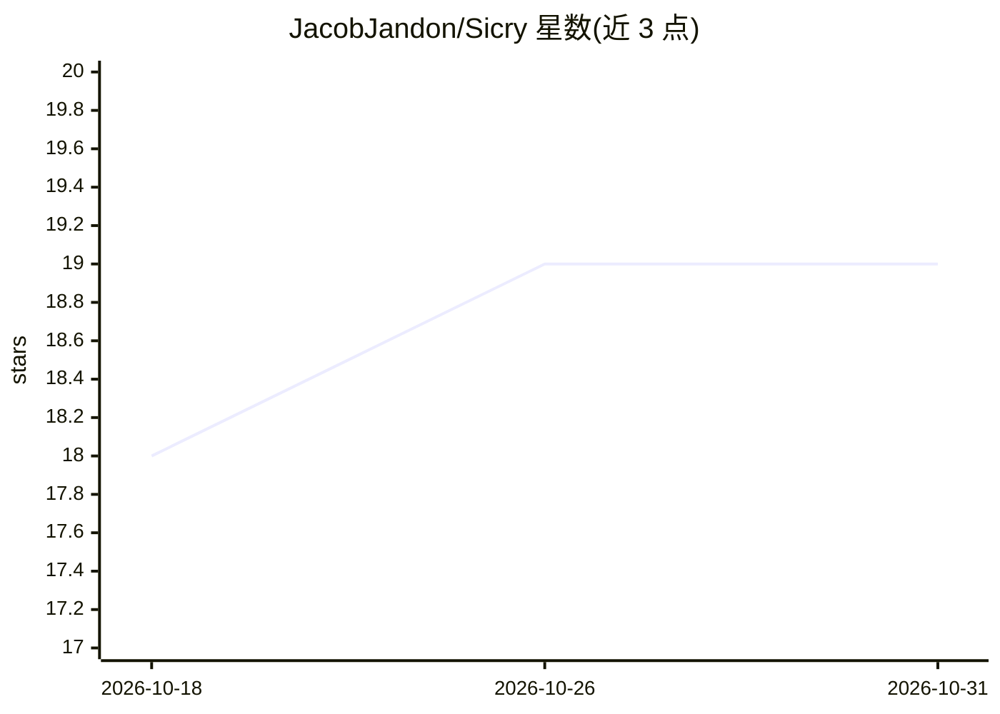

# JacobJandon/Sicry

⭐ 19 · Python · NOASSERTION · 推送 2026-10-29 · [GitHub](https://github.com/JacobJandon/Sicry) · [官网](https://github.com/JacobJandon/Sicry) · 个人维护

**给 AI agent 用的单文件 Tor/.onion 访问层与暗网 OSINT 工具集**

单个 Python 文件，为 AI agent 提供 6 个 Tor 暗网工具：连接检查、电路轮换、经 Tor 抓取 URL/暗网页面、并发查询 18 个暗网搜索引擎、批量抓取，以及调用 LLM 生成结构化 OSINT 报告（威胁情报/勒索软件/个人身份/企业四种模式）。内置 Robin 的搜索引擎目录与查询精炼、结果过滤模式，提供 Anthropic/OpenAI/Gemini 工具 schema、LangChain/CrewAI 集成示例与 MCP 服务器。需本地运行 Tor 守护进程，LLM 可用 Ollama 免 key 运行，非 LLM 工具无需任何 key。

## 筛选速览

| 维度 | 判定 | 备注 |
|---|---|---|
| AI 角色 | `ai-ecosystem` | LLM/agent 周边工具 |
| 许可风险 | `permissive` | NOASSERTION |
| 部署形态 | `library` | 以包/库形式分发 |
| 模型依赖 | local-ok | 支持本地模型 |
| 硬件要求 | — | 无带数字的原话,不猜 |
| 安装摩擦 | `low` | 无编译、无系统依赖或容器化 |
| 成熟度 | — | 结构信号不足 |

## 能力要点

- 18 个暗网搜索引擎并发查询与去重
- LLM 驱动的 OSINT 报告（4 种分析模式）与查询精炼/结果过滤
- 输出 Anthropic/OpenAI/Gemini 三种工具 schema 并内置 MCP 服务器
- Ollama 本地推理免 API key，其余工具完全无需 key

## 适用场景

- 让安全研究 agent 通过 Tor 检索和读取暗网内容
- 对暗网抓取文本生成勒索软件/数据泄露类威胁情报报告
- 通过 Claude Desktop/Cursor 的 MCP 接入暗网搜索工具

## 场景标签

`网络安全` `网页抓取` · 领域:效率与自动化

## 证据(README 行号)

> L8: One Python file. Drop it into any project and your AI agent gets full access to the Tor/.onion dark web — the same c
> L23: SICRY™ gives AI agents exactly 6 tools — the same 6 they already know how to use for the clearnet, just now running
> L276: SICRY™ exposes all 6 tools in the native format for each major framework. All three formats are always in sync.

## 星数曲线

2026-10-18 18 → 2026-10-31 19（+1）

---
*卡片 v1 · prompt 1.4 · 生成 2026-10-29 · 置信度 high · 依据 README sha `a89c7fb3b414` · [字段定义](../../DATASET.md)*
