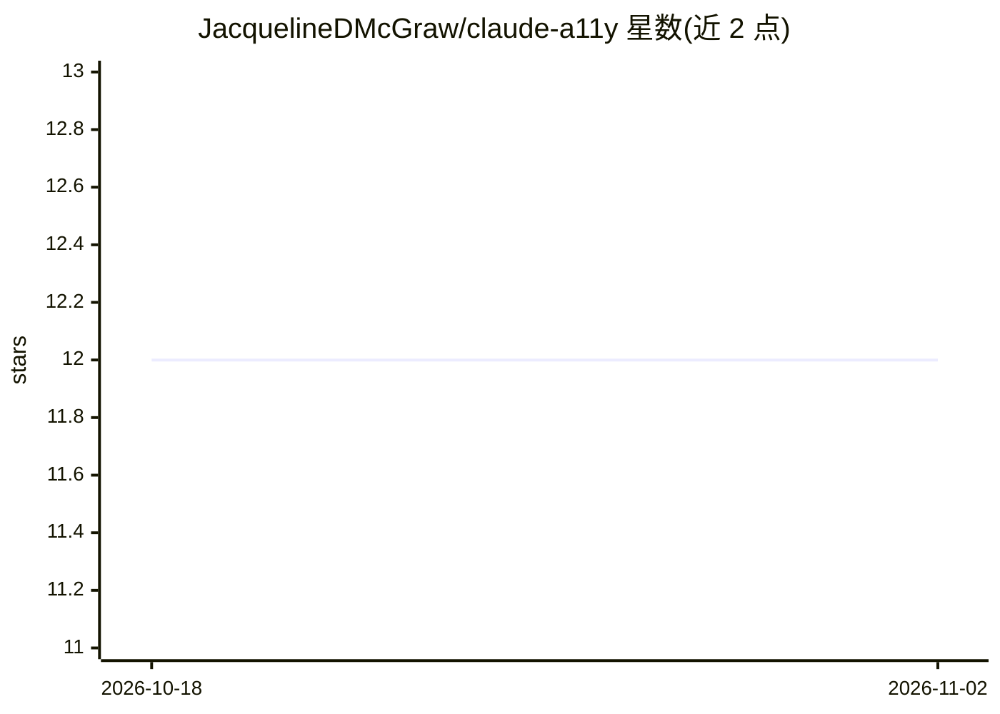

# JacquelineDMcGraw/claude-a11y

⭐ 12 · TypeScript · MIT · 推送 2026-06-12 · [GitHub](https://github.com/JacquelineDMcGraw/claude-a11y) · [官网](https://github.com/JacquelineDMcGraw/claude-a11y) · 个人维护

**为视障开发者把 AI 聊天输出格式化为屏幕阅读器友好的形式**

由残障开发者个人维护的无障碍工具集，覆盖浏览器、编辑器与终端三层：Chrome 扩展通过 MutationObserver 就地为 claude.ai 等页面注入 ARIA 角色与地标；VS Code/Cursor 扩展提供可访问聊天参与者和可配置详细度；CLI 包装器 claude-sr 以无头模式运行 Claude Code，剥离 ANSI/转轮噪声并将 markdown 解析为带结构提示的纯文本；hooks 系统把工具输出重排为简短摘要，可选 TTS 与声音提示。输入框、设置面板等部分流程尚未覆盖。

## 筛选速览

| 维度 | 判定 | 备注 |
|---|---|---|
| AI 角色 | `ai-ecosystem` | LLM/agent 周边工具 |
| 许可风险 | `permissive` | MIT |
| 部署形态 | `library` | 以包/库形式分发 |
| 模型依赖 | — | README 未给出锁定关系 |
| 硬件要求 | — | 无带数字的原话,不猜 |
| 安装摩擦 | `low` | 无编译、无系统依赖或容器化 |
| 成熟度 | — | 结构信号不足 |

## 能力要点

- 浏览器扩展就地注入 ARIA 角色与地标，支持 claude.ai/ChatGPT/Gemini/Copilot 页面
- CLI 剥离 ANSI 与 spinner 噪声，把 markdown 渲染为带 [Python]/Heading 等结构提示的纯文本
- Claude Code hooks 将工具输出重排为屏幕阅读器摘要，可选 TTS 与 earcon 音效
- 兼容 NVDA、JAWS、VoiceOver、Orca

## 适用场景

- 用屏幕阅读器顺畅使用 Claude Code 与 claude.ai 等 AI 聊天工具
- 认知处理差异或低视力用户获取无格式噪声的 AI 回复
- 在 VS Code/Cursor 中通过键盘导航在回复与代码块间跳转

## 场景标签

 · 领域:辅助技术/AI 工具无障碍

## 证据(README 行号)

> L36: claude-a11y transforms AI chat output into screen-reader-friendly markup. It works at three layers: in the browser,
> L44: - **packages/node** -- Everything that runs in Node.js. Contains the markdown-to-speech formatter, ANSI sanitizer, 

## 星数曲线

2026-10-18 12 → 2026-11-02 12（+0）

---
*卡片 v1 · prompt 1.4 · 生成 2026-11-01 · 置信度 high · 依据 README sha `18d3c2e0262b` · [字段定义](../../DATASET.md)*
