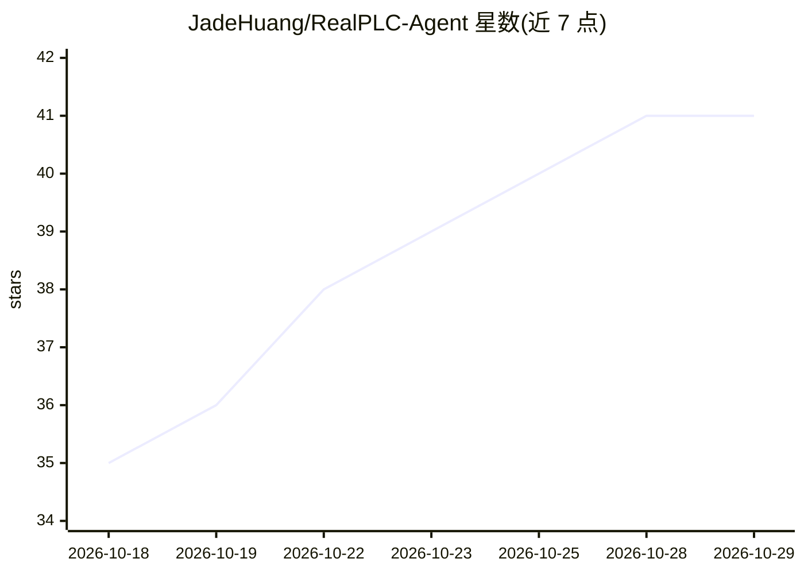

# JadeHuang/RealPLC-Agent

⭐ 41 · NOASSERTION · 推送 2026-10-12 · [GitHub](https://github.com/JadeHuang/RealPLC-Agent) · [官网](https://www.realplc.com) · 组织维护 · 中文 README

**连接 RealPLC 云端 AI 与本机 CODESYS/TIA 的 Windows 组件**

运行在 Windows 本地的工业软件连接组件：负责连接云端 RealPLC AI 与本机 PLC 开发环境（CODESYS V3.5 SP15+、Siemens TIA Portal），实现 AI 生成 Structured Text/SCL 程序后在真实工程环境中闭环验证——Generate → Validate → Diagnose → Fix → Validate Again。验证在本机执行，云端与本地工程环境分离；不自动下载到真实 PLC。面向 PLC 与工业自动化工程师，v1.1.4 为公开测试版本，提供 Windows x64 安装包。

## 筛选速览

| 维度 | 判定 | 备注 |
|---|---|---|
| AI 角色 | `ai-ecosystem` | LLM/agent 周边工具 |
| 许可风险 | `none` | NOASSERTION |
| 部署形态 | `desktop` | 安装包/桌面程序 |
| 模型依赖 | — | README 未给出锁定关系 |
| 硬件要求 | — | 无带数字的原话,不猜 |
| 安装摩擦 | `low` | 无编译、无系统依赖或容器化 |
| 成熟度 | `idea` | |

## 能力要点

- AI 生成 ST/SCL 程序并进入 CODESYS/TIA Portal 真实工程环境编译验证
- 读取原生编译诊断并回传给 AI 继续修复，形成多轮闭环
- TIA Target Project 创建/复制机制，避免直接修改用户原始工程
- 云端 AI 与本地工程环境分离，验证数据保存在本地用户应用数据目录

## 适用场景

- 让 AI 生成的 PLC 程序在 CODESYS/TIA 中获得真实编译与诊断结果
- 在工程副本或 Target Project 中反复验证 AI 修复后的程序
- 在本地管理 RealPLC 云端 AI 与 PLC 工程环境之间的连接与任务记录

## 场景标签

`编码 Agent` · 领域:编码与开发

## 证据(README 行号)

> L16: **RealPLC Agent** 是运行在 Windows 本地的工业软件连接组件。
> L18: 它负责连接 **RealPLC AI** 与本机 PLC 开发环境，让 AI 不仅能够生成 PLC 程序，还可以进一步进入真实工程环境进行验证。

## 星数曲线

2026-10-18 35 → 2026-10-29 41（+6）

---
*卡片 v1 · prompt 1.4 · 生成 2026-10-25 · 置信度 high · 依据 README sha `30bd5d0e5dd0` · [字段定义](../../DATASET.md)*
