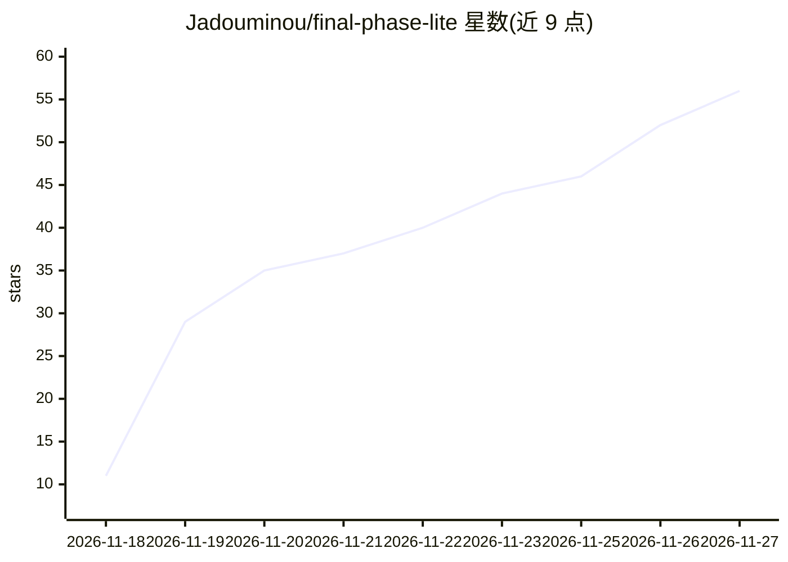

# Jadouminou/final-phase-lite

⭐ 56 · JavaScript · MIT · 推送 2026-11-17 · [GitHub](https://github.com/Jadouminou/final-phase-lite) · 个人维护

**给 Claude Code/OpenCode 视频编辑的实时预览与圈选修改窗口**

面向用 Claude Code 或 OpenCode 制作 HyperFrames 视频的用户：在浏览器中打开一个窗口，实时显示 AI 的执行步骤与计划清单，无需渲染即可逐帧播放预览（文件保存后自动刷新）。可暂停画面并圈选元素后用自然语言下达修改指令，笔记会带上帧截图、时间点与对应代码行位置。另显示每次对话与笔记的 token/费用消耗与订阅额度使用情况。支持 Claude Code 订阅、OpenCode 免费模型或 Ollama 本地模型三种路径。安装通过 ZIP 下载或 git clone 后由 Claude Code 代为完成，需 Node 20+ 与 FFmpeg。

## 筛选速览

| 维度 | 判定 | 备注 |
|---|---|---|
| AI 角色 | `ai-ecosystem` | LLM/agent 周边工具 |
| 许可风险 | `permissive` | MIT |
| 部署形态 | `None` |  |
| 模型依赖 | local-ok | 支持本地模型 |
| 硬件要求 | — | 无带数字的原话,不猜 |
| 安装摩擦 | `medium` | 含编译或系统依赖之一 |
| 成熟度 | — | 结构信号不足 |

## 能力要点

- 无需渲染的 HyperFrames 实时逐帧预览，文件变更后自动刷新
- 圈选帧上元素并附帧截图、时间点与代码行位置发给 AI 修改
- 显示每次对话/笔记的 token 与费用及订阅额度余量
- 支持 OpenCode 免费模型与 Ollama 本地模型零成本编辑

## 适用场景

- 制作 HyperFrames 视频时实时查看 AI 编辑进度
- 圈出画面中不满意的元素并让 AI 精确修改
- 用本地 Ollama 模型免费做小范围画面调整

## 场景标签

`视频生成` · 领域:内容生成

## 证据(README 行号)

> L3: A free window for the videos you make with Claude Code or OpenCode.
> L23: It runs on your computer, with your own Claude Code subscription, or with **OpenCode and its free models: no accoun
> L69: - Start an edit in the terminal like you always do, in Claude Code or OpenCode: the window follows that session by

## 星数曲线

2026-11-18 11 → 2026-11-27 56（+45）

---
*卡片 v1 · prompt 1.4 · 生成 2026-11-19 · 置信度 high · 依据 README sha `8cf377523e80` · [字段定义](../../DATASET.md)*
