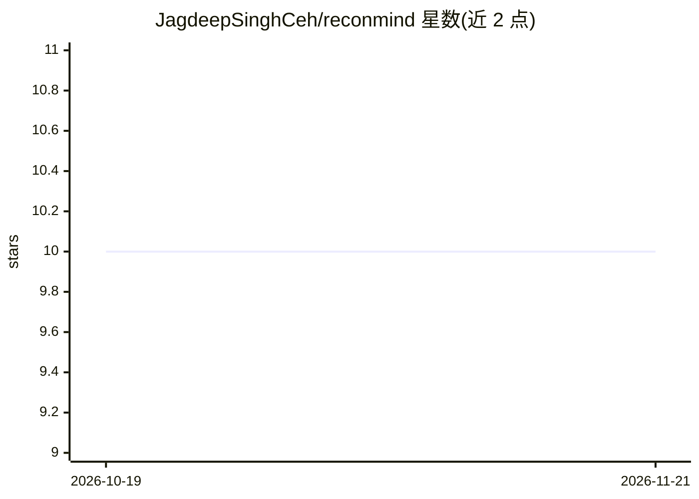

# JagdeepSinghCeh/reconmind

⭐ 10 · Python · MIT · 推送 2026-05-03 · [GitHub](https://github.com/JagdeepSinghCeh/reconmind) · 个人维护

**面向漏洞赏金猎人的 LLM 编排自动化侦察扫描与报告工具**

以 Python 编写的授权安全测试代理，将侦察、子域枚举、漏洞扫描、模糊测试、AI 分析与报告生成串联为自动化流程；由 LLM 后端（Groq/Ollama/Anthropic）在每步决定扫描目标、串联发现并过滤误报，覆盖 OWASP Top 10 类别，输出适配 HackerOne/Bugcrowd/Intigriti 格式的报告。依赖 Go 安装的 14 个外部安全工具（subfinder、nuclei、sqlmap 等），提供 setup.sh 一键安装，支持 quick/deep/api/cloud 等执行档位与断点续跑。

## 筛选速览

| 维度 | 判定 | 备注 |
|---|---|---|
| AI 角色 | `ai-native` | 本体是模型或模型工具 |
| 许可风险 | `permissive` | MIT |
| 部署形态 | `library` | 以包/库形式分发 |
| 模型依赖 | local-ok | 支持本地模型 |
| 硬件要求 | — | 无带数字的原话,不猜 |
| 安装摩擦 | `low` | 无编译、无系统依赖或容器化 |
| 成熟度 | — | 结构信号不足 |

## 能力要点

- Recon→Enum→Scan→Fuzz→AI分析→Report 全流程自动化链
- 三档 LLM 后端可切换：Groq（免费 API）、Ollama（本地）、Anthropic（付费）
- 覆盖 OWASP Top 10 测试项，AI 验证发现并识别攻击链
- 输出 HackerOne/Bugcrowd/Intigriti 平台格式报告，支持 checkpoint 续跑

## 适用场景

- 对已授权的目标域名执行自动化侦察与漏洞扫描
- 用测试站点（如 testphp.vulnweb.com）练习渗透测试流程
- 在本地 Ollama 离线环境下运行安全扫描
- 将扫描发现整理为漏洞赏金平台的提交报告

## 场景标签

`网络安全` · 领域:学习与行业

## 证据(README 行号)

> L11: **An autonomous, LLM-orchestrated bug bounty hunting agent built for serious hunters.**
> L20: ReconMind is an AI-powered bug bounty agent that thinks and hunts like a **senior penetration tester**. Instead of 
> L12: Chains Recon → Enum → Scan → Fuzz → AI Analysis → Report — fully automated.

## 星数曲线

2026-10-19 10 → 2026-11-21 10（+0）

---
*卡片 v1 · prompt 1.4 · 生成 2026-11-20 · 置信度 high · 依据 README sha `eb73890fc97a` · [字段定义](../../DATASET.md)*
