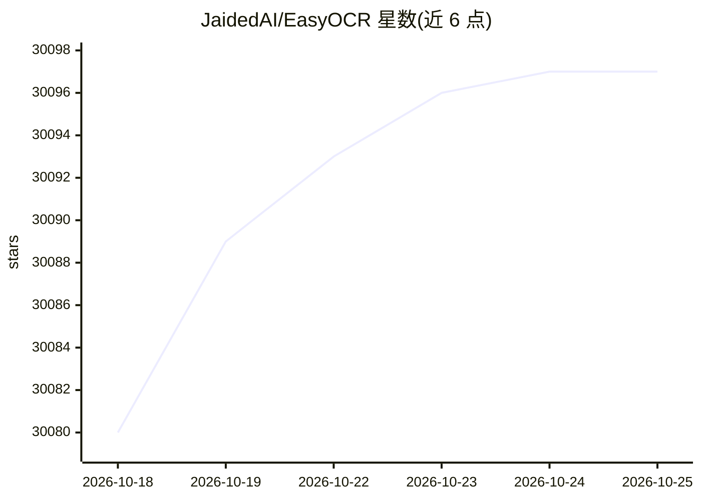

# JaidedAI/EasyOCR

⭐ 30,097 · Python · Apache-2.0 · 推送 2025-12-05 · [GitHub](https://github.com/JaidedAI/EasyOCR) · [官网](https://www.jaided.ai) · 组织维护

**支持80+语言的即用型 OCR 图文识别库**

基于 PyTorch 的开源 OCR 库：检测端使用 CRAFT 算法，识别端使用 CRNN（Resnet/VGG 特征提取 + LSTM 序列标注 + CTC 解码），支持拉丁、中文、阿拉伯、天城文、西里尔等 80+ 种语言的文字检测与识别，输出边界框、文本与置信度。以 Python 包与命令行两种方式使用，模型权重自动下载或从模型库手动放置；无 GPU 或显存不足时可切换 CPU-only 模式。手写体识别尚在开发计划中，新语言需按流程提交字符表与词典 PR。

## 筛选速览

| 维度 | 判定 | 备注 |
|---|---|---|
| AI 角色 | `ai-ecosystem` | LLM/agent 周边工具 |
| 许可风险 | `permissive` | Apache-2.0 |
| 部署形态 | `self-host` | docker 或自建部署 |
| 模型依赖 | — | README 未给出锁定关系 |
| 硬件要求 | `cpu-ok` | |
| 安装摩擦 | `low` | 无编译、无系统依赖或容器化 |
| 成熟度 | — | 结构信号不足 |

## 动量与使用信号

- 维护:`declining` — 距上次 push 316.8 天,年发版 0,115 位贡献者
- 涨星:近 1 天 **+6**(自 20261016 起算)
- 安装:pypi 包 `easyocr` 月下载 1,927,066
- 平台:WINDOWS · 协议:—

## 能力要点

- 支持 80+ 语言与主流书写系统，多语言可同时传入识别
- 检测用 CRAFT、识别用 CRNN（Resnet/VGG + LSTM + CTC）
- 提供 Python API 与命令行两种使用方式，模型权重自动下载
- GPU 不可用或显存低时可用 gpu=False 以 CPU 模式运行

## 适用场景

- 从图片中提取多语言文字及其位置和置信度
- 接入 Python 项目或脚本做批量图片 OCR
- 训练或替换自己的检测/识别模型

## 场景标签

`OCR` · 领域:感知与多模态

## 证据(README 行号)

> L8: Ready-to-use OCR with 80+ supported languages and all popular writing scripts including: Latin, Chinese, Arabic, Dev
> L84: In case you do not have a GPU, or your GPU has low memory, you can run the model in CPU-only mode by adding `gpu=Fa
> L120: All deep learning execution is based on Pytorch. :heart:

## 星数曲线

2026-10-18 30,080 → 2026-10-25 30,097（+17）

---
*卡片 v1 · prompt 1.4 · 生成 2026-10-18 · 置信度 high · 依据 README sha `39ff5f35cf49` · [字段定义](../../DATASET.md)*
