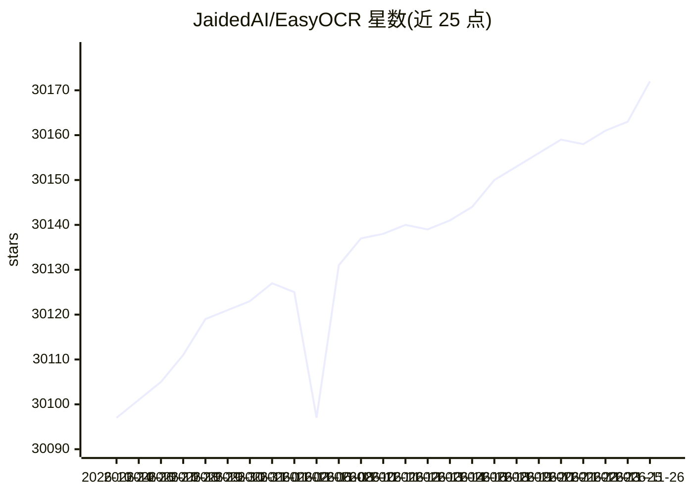

# JaidedAI/EasyOCR

⭐ 30,172 · Python · Apache-2.0 · 推送 2026-11-13 · [GitHub](https://github.com/JaidedAI/EasyOCR) · [官网](https://www.jaided.ai) · 组织维护

**支持80+语言的即用型OCR识别库**

基于 PyTorch 的开源 OCR 库，支持 80 多种语言与主流文字系统（拉丁、中文、阿拉伯、天城文、西里尔等）。检测端使用 CRAFT 算法，识别端使用 CRNN（Resnet/VGG 特征提取 + LSTM + CTC 解码）。以 Python 库与命令行两种方式调用，读取图片路径、numpy 数组、字节或 URL，输出包围框、文本与置信度；模型权重自动下载，也可手动放入 ~/.EasyOCR/model。无 GPU 或显存不足时可用 CPU 模式。企业支持由 Jaided AI 商业提供。

## 筛选速览

| 维度 | 判定 | 备注 |
|---|---|---|
| AI 角色 | `ai-native` | 本体是模型或模型工具 |
| 许可风险 | `permissive` | Apache-2.0 |
| 部署形态 | `self-host` | docker 或自建部署 |
| 模型依赖 | — | README 未给出锁定关系 |
| 硬件要求 | `cpu-ok` | |
| 安装摩擦 | `low` | 无编译、无系统依赖或容器化 |
| 成熟度 | — | 结构信号不足 |

## 动量与使用信号

- 维护:`declining` — 距上次 push 316.8 天,年发版 0,115 位贡献者
- 涨星:近 1 天 **+6**(自 20261016 起算)
- 安装:pypi 包 `easyocr` 月下载 1,927,066
- 平台:WINDOWS · 协议:—

## 能力要点

- 支持 80+ 语言与多种文字脚本，可一次传入多语言组合识别
- 输出包围框坐标、检测文本与置信度，支持 detail=0 简化输出
- 模型权重自动下载，支持手动放置到 model 目录
- 提供命令行用法与 Dockerfile；可选 DBNet 检测器（dbnet18）

## 适用场景

- 对含中文、英文等多语言混合的图片做文字识别
- 在无 GPU 的环境下用 CPU 模式批量识别图片文本
- 训练或替换自己的检测/识别模型接入 EasyOCR 流水线

## 场景标签

`OCR` · 领域:感知与多模态

## 证据(README 行号)

> L8: Ready-to-use OCR with 80+ supported languages and all popular writing scripts including: Latin, Chinese, Arabic, Dev
> L122: All deep learning execution is based on Pytorch. :heart:

## 星数曲线

2026-10-24 30,097 → 2026-11-26 30,172（+75）

---
*卡片 v1 · prompt 1.4 · 生成 2026-11-22 · 置信度 mid · 依据 README sha `eadd124ca172` · [字段定义](../../DATASET.md)*
