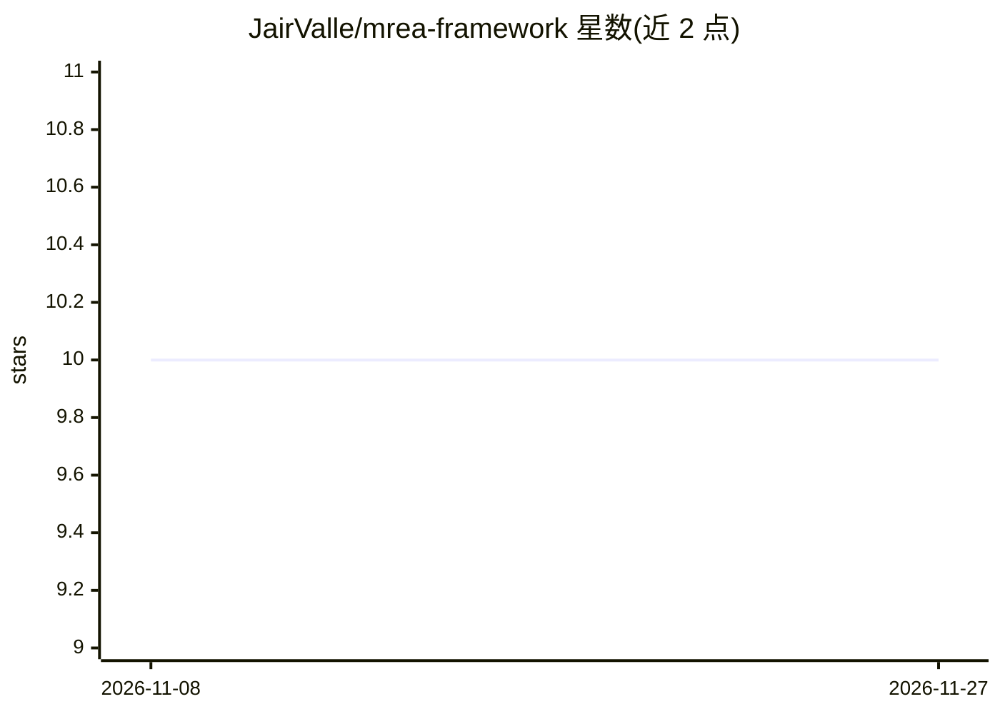

# JairValle/mrea-framework

⭐ 10 · MIT · 推送 2026-08-26 · [GitHub](https://github.com/JairValle/mrea-framework) · 个人维护

**企业 AI 辅助开发的多角色治理框架，含质量门与人工审批**

面向企业级软件开发的 AI 多角色治理框架：将 AI 辅助开发组织为受控流水线，设 Orchestrator 主代理统一入口，下分架构、审计、实现等子代理，强制设计-审计-实现的角色分离与人工审批后才改代码。核心提示词与平台无关，仓库提供 OpenCode 适配器；给出按任务复杂度做模型路由的建议配置与技能目录扩展机制。以 git clone 获取后在所选平台中运行，无独立运行时。

## 筛选速览

| 维度 | 判定 | 备注 |
|---|---|---|
| AI 角色 | `ai-ecosystem` | LLM/agent 周边工具 |
| 许可风险 | `permissive` | MIT |
| 部署形态 | `None` |  |
| 模型依赖 | — | README 未给出锁定关系 |
| 硬件要求 | — | 无带数字的原话,不猜 |
| 安装摩擦 | `low` | 无编译、无系统依赖或容器化 |
| 成熟度 | `idea` | |

## 能力要点

- Orchestrator 主代理 + 6 类子代理的层级与权限边界
- 重大变更强制独立审计与人工审批的质量门机制
- 核心提示词平台无关，附 OpenCode 完整适配器
- 按任务复杂度的模型路由建议与技能目录扩展

## 适用场景

- 3-5 人以上团队为 AI 辅助开发引入审批与审计流程
- 企业代码库中约束 AI 代理的权限与改动范围
- 按任务复杂度分配不同成本的模型以控制 token 消耗

## 场景标签

`Agent 框架` `多智能体` · 领域:Agent 开发

## 证据(README 行号)

> L7: > **A governance framework for AI-assisted enterprise software development.**
> L50: MREA treats AI-assisted development as a controlled pipeline instead of a conversation.
> L77: > **The Orchestrator is the primary agent** — the single entry point for all requests. It coordinates the workflow,

## 星数曲线

2026-11-08 10 → 2026-11-27 10（+0）

---
*卡片 v1 · prompt 1.4 · 生成 2026-11-20 · 置信度 high · 依据 README sha `c2906cb49fc5` · [字段定义](../../DATASET.md)*
