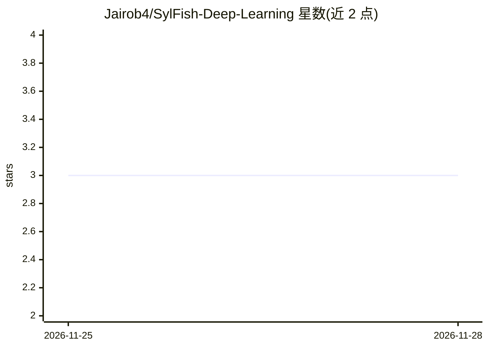

# Jairob4/SylFish-Deep-Learning

⭐ 3 · Jupyter Notebook · 推送 2026-11-24 · [GitHub](https://github.com/Jairob4/SylFish-Deep-Learning) · 个人维护

**鱼类图像分类与分割系统：识别鱼种并生成轮廓掩码**

基于 SylFishBD 数据集（9075 张图、9 个鱼种）的课程项目，接收一张鱼的照片，用 EfficientNetB0 输出鱼种与置信度，用二值 U-Net v2 输出鱼/背景掩码，Gradio 界面在 Colab 运行并返回带轮廓与面积摘要的图像。关键机制：按 MD5 与 dHash 汉明距离≤5 的重复组做无泄漏 70/15/15 划分；因数据集无掩码标注，用 Meta SAM 2 离线生成伪标签后从头重训 U-Net v2，掩码 QC 通过率从 79.3% 升至 97.0%。数据、掩码与模型存于 Google Drive，仓库仅含笔记本与文档。

## 筛选速览

| 维度 | 判定 | 备注 |
|---|---|---|
| AI 角色 | `ai-native` | 本体是模型或模型工具 |
| 许可风险 | `none` | — |
| 部署形态 | `None` |  |
| 模型依赖 | — | README 未给出锁定关系 |
| 硬件要求 | — | 无带数字的原话,不猜 |
| 安装摩擦 | `low` | 无编译、无系统依赖或容器化 |
| 成熟度 | — | 结构信号不足 |

## 能力要点

- EfficientNetB0 分类与 U-Net v2 分割两个独立模型，仅在 demo 中联合
- dHash/MD5 按重复组划分数据集，防止副本跨集泄漏
- SAM 2 离线伪标签替代 GrabCut，掩码 QC 通过率 79.3%→97.0%
- test 集冻结模型一次性评估，全部决策在验证集做出

## 适用场景

- 上传鱼类照片获取物种与置信度并生成轮廓掩码
- 学习无标注数据的伪标签分割训练流程
- 参考防泄漏数据集划分方法处理含副本的数据

## 场景标签

`目标检测` `图像视频处理` · 领域:感知与多模态

## 证据(README 行号)

> L5: El sistema recibe la fotografía de un pez y responde dos cosas: de qué especie es, con qué confianza, y dónde está. 
> L31: **Idea.** Usar **SAM 2** (Segment Anything Model 2, de Meta) como herramienta de **etiquetado offline**: genera más

## 星数曲线

2026-11-25 3 → 2026-11-28 3（+0）

---
*卡片 v1 · prompt 1.4 · 生成 2026-11-24 · 置信度 high · 依据 README sha `988154af75ef` · [字段定义](../../DATASET.md)*
