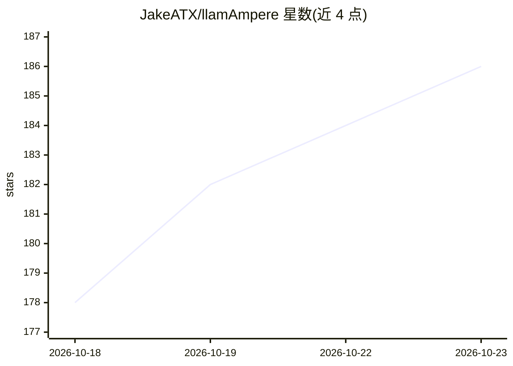

# JakeATX/llamAmpere

⭐ 186 · C++ · MIT · 推送 2026-10-22 · [GitHub](https://github.com/JakeATX/llamAmpere) · 个人维护

**面向 RTX 3090/3090 Ti 优化的 llama.cpp fork，本地长上下文推理**

llama.cpp 的 fork，针对 Ampere 架构（SM86，RTX 3090/3090 Ti）调优，运行 Qwen3.8-27B 等 GGUF 模型并支持其 MTP draft head 做投机解码。提供 SJ-KVaRN 压缩 KV cache（4/4 配置下 262,144-token 上下文可放入单张 24 GB 显卡）、默认开启的 RAM+磁盘两级 prompt cache、OpenAI 兼容 API 的 llama-server，以及 12 GB 显卡跑 200K+ 上下文的低内存配置。需在 Linux 下用 CUDA toolkit 从源码编译，其他 NVIDIA 卡可编译但未调优。

## 筛选速览

| 维度 | 判定 | 备注 |
|---|---|---|
| AI 角色 | `ai-ecosystem` | LLM/agent 周边工具 |
| 许可风险 | `permissive` | MIT |
| 部署形态 | `desktop` | 安装包/桌面程序 |
| 模型依赖 | — | README 未给出锁定关系 |
| 硬件要求 | `gpu-8g` | |
| 安装摩擦 | `high` | 编译与系统依赖俱全 |
| 成熟度 | — | 结构信号不足 |

## 能力要点

- SJ-KVaRN 压缩 KV cache，24 GB 卡支持 262,144-token 上下文
- MTP 投机解码默认开启，新 verify 内核提升解码速度
- RAM + 磁盘两级 prompt cache 默认开启，恢复会话免重 prefill
- 12 GB 显卡（RTX 3060 等）可跑 204,800-token 上下文

## 适用场景

- 在单张 RTX 3090/3090 Ti 上本地运行长上下文 LLM 推理
- 显存受限（12 GB）环境下跑 200K+ 上下文模型
- 通过 OpenAI 兼容 API 本地部署 agentic/RAG 长会话服务

## 场景标签

`推理引擎` `模型量化` · 领域:训练与推理

## 证据(README 行号)

> L1: > **llamAmpere v0.5.5**: a llama.cpp fork tuned for the RTX 3090 / 3090 Ti (Ampere, SM86), running Qwen3.8-27B with 
> L37: **Build and run (v0.5.4, one RTX 3090 / 3090 Ti, 262,144-token context).** Needs Linux, an NVIDIA card with 24 GB, 

## 星数曲线

2026-10-18 178 → 2026-10-23 186（+8）

---
*卡片 v1 · prompt 1.4 · 生成 2026-10-22 · 置信度 high · 依据 README sha `d4784ca15246` · [字段定义](../../DATASET.md)*
