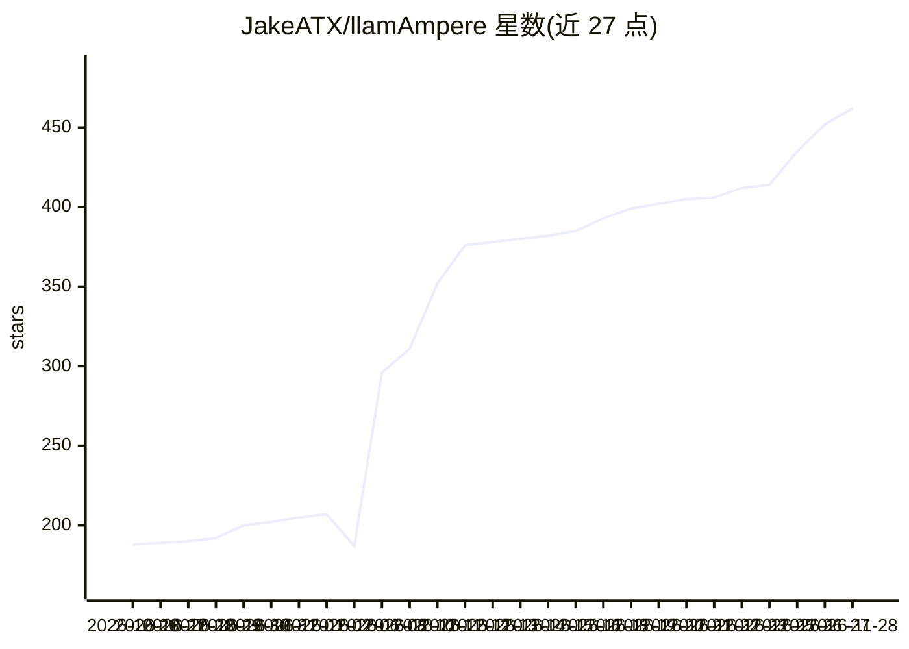

# JakeATX/llamAmpere

⭐ 462 · C++ · MIT · 推送 2026-11-27 · [GitHub](https://github.com/JakeATX/llamAmpere) · 个人维护

**面向 RTX 30 系显卡调优的 llama.cpp 分支，本地运行 LLM**

基于 mainline llama.cpp v1.0 的分支，针对 NVIDIA RTX 30 系列（8 GB RTX 3070 至 24 GB RTX 3090）调整 GPU 代码，并按显存大小提供预设模型文件与一键 `--preset`。机制包括 drafter 辅助模型投机解码、Qwen3.8 27B 内置 MTP、4-bit KV cache 量化，README 附各显卡实测解码速度表。支持 Linux 与 Windows、文本与图像输入、OpenAI 兼容服务器。Releases 提供预编译包，源码构建与 Docker 说明在 docs/SETUP.md。

## 筛选速览

| 维度 | 判定 | 备注 |
|---|---|---|
| AI 角色 | `ai-ecosystem` | LLM/agent 周边工具 |
| 许可风险 | `permissive` | MIT |
| 部署形态 | `desktop` | 安装包/桌面程序 |
| 模型依赖 | local-ok | 支持本地模型 |
| 硬件要求 | — | 无带数字的原话,不猜 |
| 安装摩擦 | `medium` | 含编译或系统依赖之一 |
| 成熟度 | — | 结构信号不足 |

## 能力要点

- 为 8/10/12/24 GB RTX 30 系显卡各提供 `--preset` 与配套模型文件
- drafter 投机解码与 Qwen3.8 27B 内置 MTP 加速生成
- 4-bit KV cache 量化，最长支持 262K（可至 614,400）上下文
- OpenAI 兼容 API 服务器与 Web UI，支持 image_url 图像输入

## 适用场景

- 在 RTX 3090/3080/3070 上本地运行大语言模型
- 单卡跑 20 万以上 token 长上下文任务
- 本地起 OpenAI 兼容服务器供客户端调用

## 场景标签

`推理引擎` `模型量化` · 领域:训练与推理

## 证据(README 行号)

> L3: llamAmpere is llama.cpp (the open-source program that runs AI language models on your own PC) tuned for NVIDIA RTX
> L5: faster GPU code, model files sized for each card, and one `--preset` per card that sets everything up. Linux and
> L77: The server listens on http://127.0.0.1:8080 with an OpenAI-compatible API and a web UI. The preset sets context,

## 星数曲线

2026-10-26 188 → 2026-11-28 462（+274）

---
*卡片 v1 · prompt 1.4 · 生成 2026-11-28 · 置信度 high · 依据 README sha `586daab08a94` · [字段定义](../../DATASET.md)*
