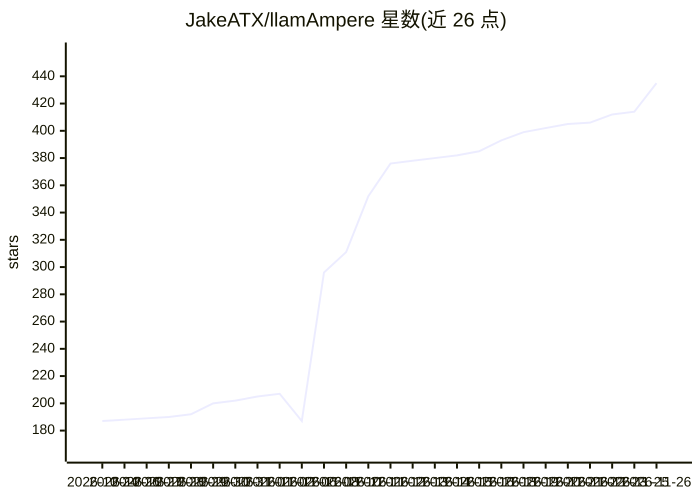

# JakeATX/llamAmpere

⭐ 435 · C++ · MIT · 推送 2026-11-25 · [GitHub](https://github.com/JakeATX/llamAmpere) · 个人维护

**针对 RTX 30 系显卡优化的 llama.cpp 推理运行时 fork**

基于 mainline llama.cpp v1.0 的 fork，面向 NVIDIA RTX 30 系（Ampere）显卡调优，运行 Qwen3.8 系列模型。核心机制包括：mb-MTP 推测解码（默认开启的 MTP 草稿头）、Flash-Next 专家显存/RAM 分层、KV 缓存量化与 AI+ 自研权重格式；按显存档位提供 24/12/10/8 GB 的卡片预设（--preset 24dense 等），并区分有头/无头模式的上下文默认值。提供 llama-server/llama-cli 运行方式，release 附 Ubuntu 与 Windows 构建。多用户支持为未来工作。

## 筛选速览

| 维度 | 判定 | 备注 |
|---|---|---|
| AI 角色 | `ai-ecosystem` | LLM/agent 周边工具 |
| 许可风险 | `permissive` | MIT |
| 部署形态 | `desktop` | 安装包/桌面程序 |
| 模型依赖 | local-ok | 支持本地模型 |
| 硬件要求 | — | 无带数字的原话,不猜 |
| 安装摩擦 | `medium` | 含编译或系统依赖之一 |
| 成熟度 | — | 结构信号不足 |

## 能力要点

- 基于 llama.cpp v1.0，针对 RTX 30 系 Ampere 卡调优
- 按显存档位的卡片预设（24dense/12dense/10dense/8dense）
- mb-MTP 推测解码与 MTP 草稿头加速生成
- AI+ 自研权重格式（较 IQ4_XS-M 更低 KL）

## 适用场景

- 在 RTX 3090/3080 等消费级显卡上本地运行 Qwen3.8-27B
- 低显存（8-12 GB）配置下跑 200K+ 长上下文
- 为编码 agent 提供本地 llama-server 推理后端

## 场景标签

`推理引擎` `模型量化` · 领域:训练与推理

## 证据(README 行号)

> L3: llamAmpere is based on mainline llama.cpp (v1.0), tuned for NVIDIA RTX 30-series Ampere cards. With 1.0 we prioritiz
> L100: llama-server --preset 24dense -m /path/to/qwen3.8-27b-Swift1.5-Uncensored-ATX-AI4.gguf

## 星数曲线

2026-10-24 187 → 2026-11-26 435（+248）

---
*卡片 v1 · prompt 1.4 · 生成 2026-11-25 · 置信度 mid · 依据 README sha `8f8acd30dcaf` · [字段定义](../../DATASET.md)*
