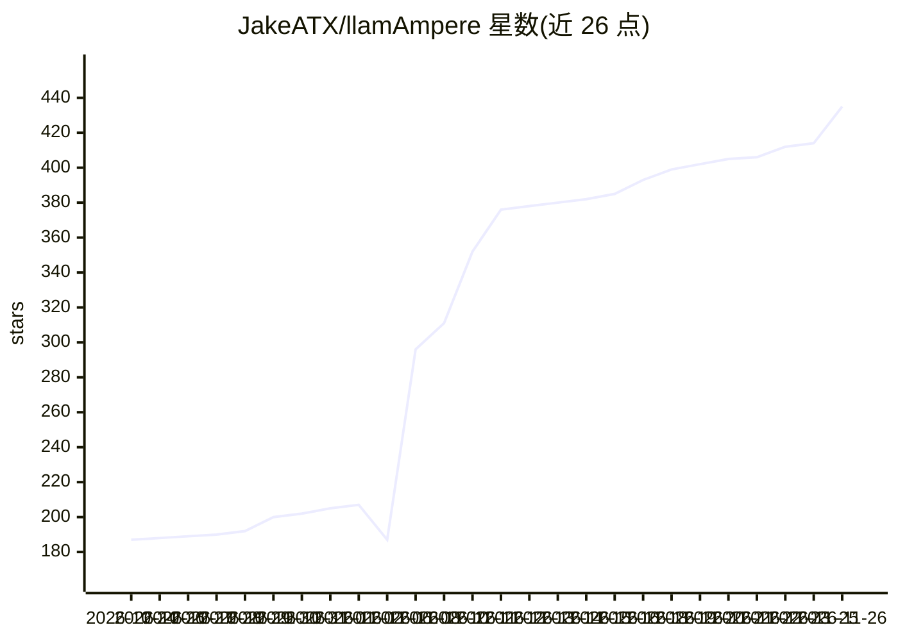

# JakeATX/llamAmpere

⭐ 435 · C++ · MIT · 推送 2026-11-25 · [GitHub](https://github.com/JakeATX/llamAmpere) · 个人维护

**针对 RTX 30 系 Ampere 显卡优化的 llama.cpp 分支推理运行时**

基于主线 llama.cpp (v1.0) 的分支，面向 NVIDIA RTX 30 系 Ampere 显卡调优，纳入 TurboQuant 量化工作。运行 Qwen3.8（含 27B 内置 MTP 草稿头）、Flash-Next 与 Inkling 2 Mini 等模型，提供按显存大小划分的预设（24ink/12ink/10ink/8ink 等），支持长上下文、KV 缓存量化、专家权重显存/内存分配，并通过 MTP/草稿头机制加速解码。发布页提供 Linux tar 与 Windows zip 二进制，需 NVIDIA 驱动 R550+。README 未提供 Docker 镜像与 pip 安装方式。

## 筛选速览

| 维度 | 判定 | 备注 |
|---|---|---|
| AI 角色 | `ai-ecosystem` | LLM/agent 周边工具 |
| 许可风险 | `permissive` | MIT |
| 部署形态 | `desktop` | 安装包/桌面程序 |
| 模型依赖 | local-ok | 支持本地模型 |
| 硬件要求 | — | 无带数字的原话,不猜 |
| 安装摩擦 | `low` | 无编译、无系统依赖或容器化 |
| 成熟度 | — | 结构信号不足 |

## 能力要点

- 按显卡显存划分的运行预设（24/12/10/8 GB 卡各有对应 preset）
- MTP 草稿头与 KV 缓存量化（SJ-KVaRN 4-bit）用于解码加速
- 支持最长 385K–614K 上下文与 12 GB 低显存长上下文配置
- 附带 mmproj 文件可处理图像输入

## 适用场景

- 在 RTX 3090 等消费级显卡上本地运行 Qwen3.8 长上下文推理
- 8–12 GB 显存卡上通过专家放内存运行大上下文模型
- 为本地编码 agent 提供兼容 Claude Code 的推理后端

## 场景标签

`推理引擎` `模型量化` · 领域:训练与推理

## 证据(README 行号)

> L3: llamAmpere is based on mainline llama.cpp (v1.0), tuned for NVIDIA RTX 30-series Ampere cards. With 1.0 we prioritiz
> L5: It runs Qwen3.8 models, including Qwen3.8-27B with its built-in MTP draft head (a small helper that guesses several 
> L145: ./llama-server --preset 24ink -m /path/to/Inkling-2-Mini-ATX-NVFP4Q8-5.4bpw.gguf -md /path/to/Inkling-2-Mini-ATX-D

## 星数曲线

2026-10-24 187 → 2026-11-26 435（+248）

---
*卡片 v1 · prompt 1.4 · 生成 2026-11-26 · 置信度 mid · 依据 README sha `ef26c730a9d1` · [字段定义](../../DATASET.md)*
