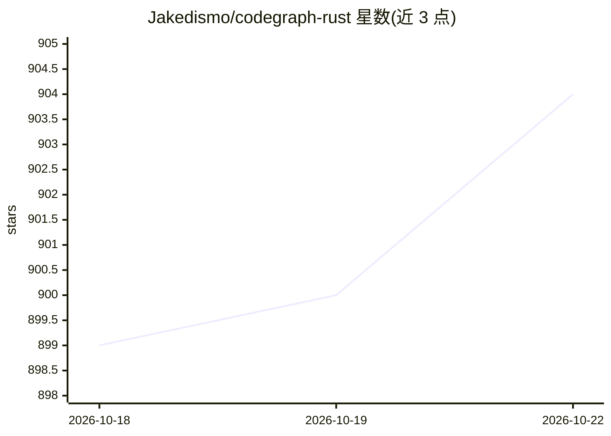

# Jakedismo/codegraph-rust

⭐ 905 · Rust · 推送 2026-10-12 · [GitHub](https://github.com/Jakedismo/codegraph-rust) · 个人维护

**为 AI 编程助手提供代码知识图谱与语义检索的 Rust 工具**

用 Rust 实现的代码 GraphRAG 工具：将代码库经 AST + FastML 解析、LSP 符号解析与富化处理，构建含模块、数据流、文档节点的知识图谱并存入 SurrealDB，配合嵌入做混合语义检索，通过 MCP 向编码 agent 提供四个工具，也提供 CLI 与 Claude Code/Codex 本地钩子。索引分 fast/balanced/full 三档，LSP 档位要求各语言对应的语言服务器（rust-analyzer、pyright 等）预先安装。嵌入支持 Ollama 等本地与云端提供方，分块从 AST 节点 span 出发并按 token 预算切分。

## 筛选速览

| 维度 | 判定 | 备注 |
|---|---|---|
| AI 角色 | `ai-ecosystem` | LLM/agent 周边工具 |
| 许可风险 | `none` | — |
| 部署形态 | `None` |  |
| 模型依赖 | local-ok | 支持本地模型 |
| 硬件要求 | — | 无带数字的原话,不猜 |
| 安装摩擦 | `low` | 无编译、无系统依赖或容器化 |
| 成熟度 | — | 结构信号不足 |

## 能力要点

- AST + FastML + LSP 解析构建代码知识图谱并存入 SurrealDB
- fast/balanced/full 三档索引可选速度与图丰富度
- 通过 MCP 提供 4 个 agentic 工具，另有 CLI 与 Claude Code/Codex 钩子
- 增量索引复用缓存工件，仅写入变更记录；支持延迟嵌入任务

## 适用场景

- 为 AI 编程助手提供跨文件的代码架构上下文
- 基于图遍历+语义混合检索定位函数及其依赖关系
- 索引后做影响分析与架构信号（包循环）检查

## 场景标签

`知识图谱` `语义搜索` · 领域:知识与检索

## 证据(README 行号)

> L18: CodeGraph transforms your entire codebase into a semantically searchable knowledge graph that AI agents can actuall
> L25: > agentic tools are available through the CLI, with project-local Claude Code/Codex hooks.
> L41: Your Code → Build Context → AST + FastML → LSP Resolution → Enrichment → Graph + Embeddings

## 星数曲线

2026-10-18 899 → 2026-10-22 904（+5）

---
*卡片 v1 · prompt 1.4 · 生成 2026-10-21 · 置信度 high · 依据 README sha `bf9d4a427106` · [字段定义](../../DATASET.md)*
